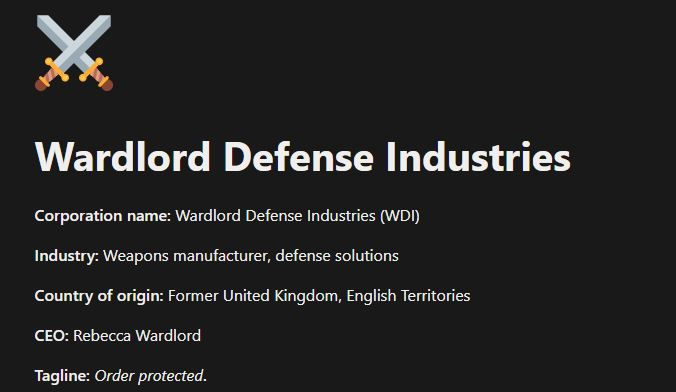
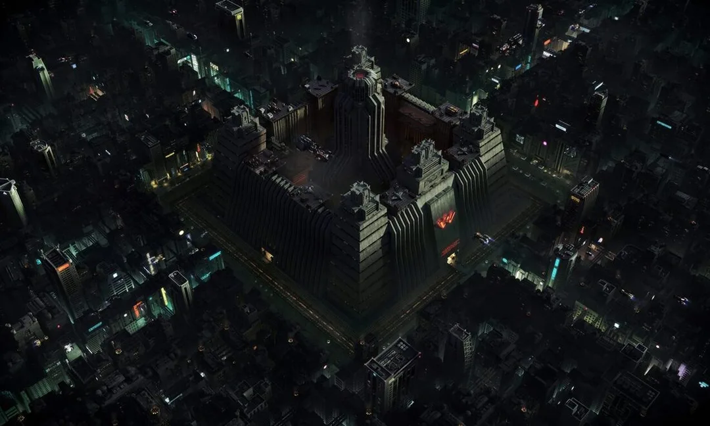
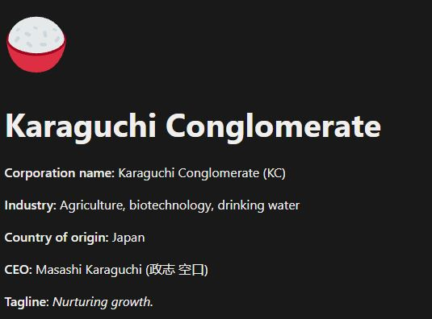
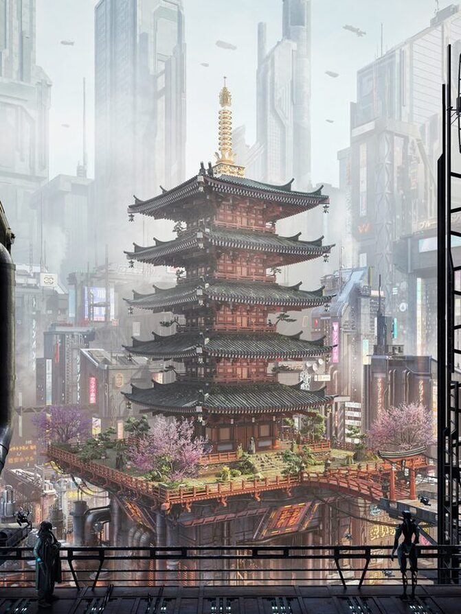
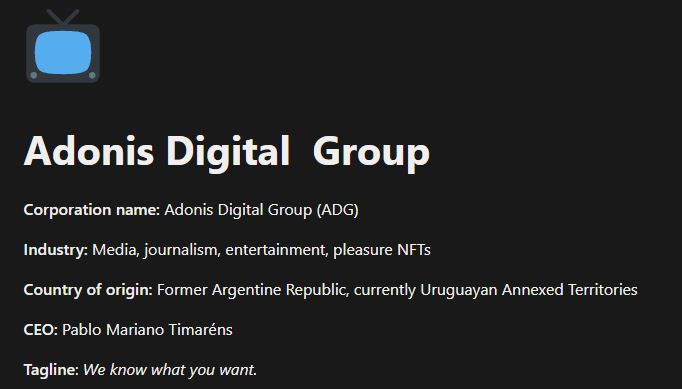
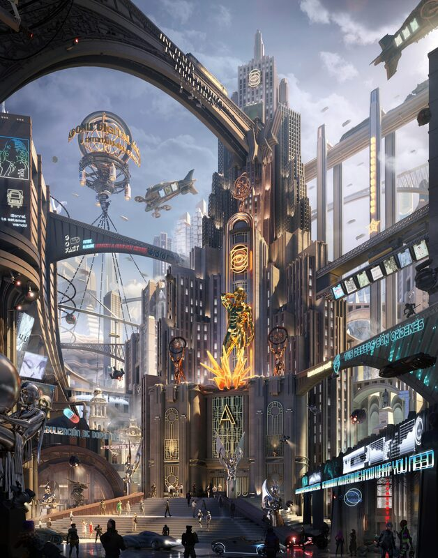
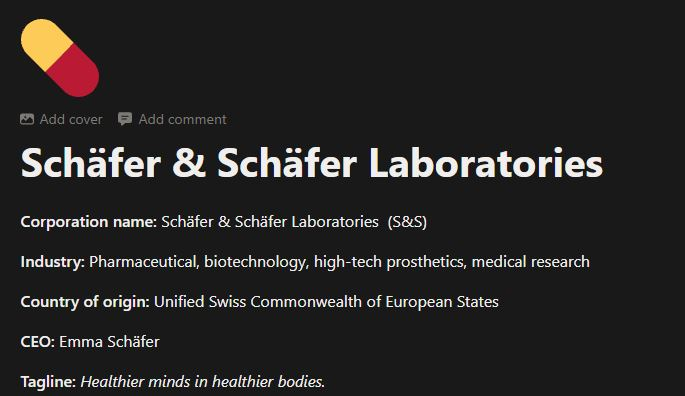
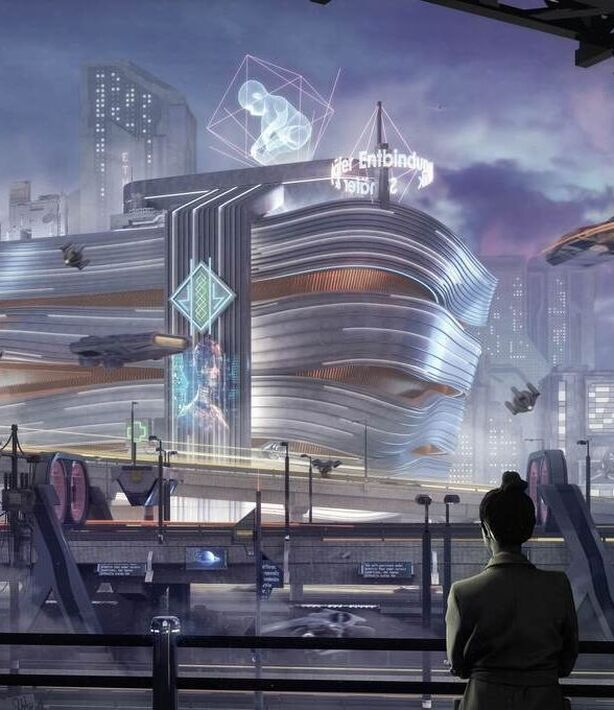
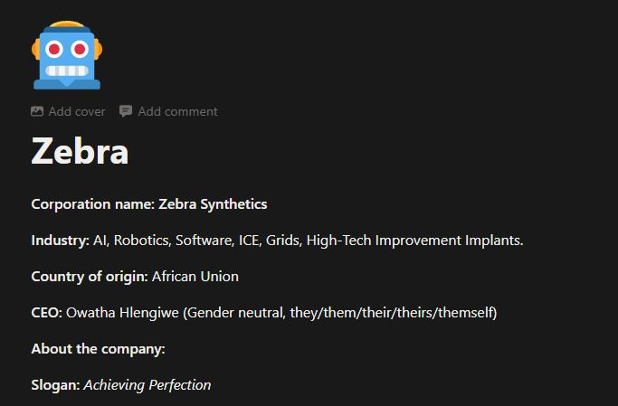
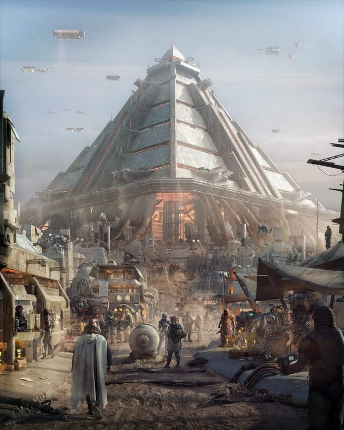

In the previous entry, I talked about how we didn't yet know what the world we were building would be used for, but had a solid sense of the elements it needed. Whatever product we ended up making, it would be cyberpunk, with five megacorporations ruling a dystopian future and five factions of hackers opposing them. That distribution wasn't arbitrary: five of each gave us variety and room for both storytelling and experience design without spreading the audience's attention too thin.

And I didn't make that decision on my own. It was discussed and agreed upon by me, as the narrative designer, and the founders of **Flatline Studios**, as the project's stakeholders. That last word might feel cold and corporate, the opposite of what we want in a creative endeavour, but I think it's the right one: a stakeholder is someone with a vested interest in an activity's success. And who has more of a vested interest in my work than the people who hired me to do it? Keeping them involved gave me direction and some peace of mind. I like to measure ten times and cut once, rather than measure once and cut ten times. Checking with them that the groundwork for the world-building matched what they had in mind (or at least was something different but equally acceptable) meant my time and effort weren't going to waste. And since we were (and still are) a small team that wanted everyone to feel free to give their input on everything, the whole process was full of moments like "what do you think it'd be cool to include in our world?" or "here's what I'd really like to incorporate in some way." Looking back, I can't always tell who first suggested what: ideas passed through so many hands in those sessions that I'd rather credit the team than guess.

So: five hacker factions and five antagonistic corporations. We had defined what we needed to build; now I had to build it. I started with the corporations, asking the questions that seemed relevant given that starting point. In this dystopian world ruled by corporations, which ones would concentrate the most power? I wanted them to be equally strong, so they could cooperate or compete as the narrative needed. That meant giving each one a well-differentiated industry, so they could dominate different aspects of the world.

I asked myself, "What kind of companies would rule the future?" Since this project was about a not-so-distant fictional future, I looked at my present. War seemed to me an evergreen industry: always fashionable, always relevant, always shady, always pulling strings behind the curtain. Weapons, ammunition and private security, then, had to be at the core of one of our megacorporations, a militaristic, warmongering behemoth. One down, four to go.

The next one felt obvious: the sustenance of life, food and water. But it was hard for me to imagine a company controlling food and water worldwide (I know, how innocent). I needed an event, or events, that reshaped how food and water were produced on a global scale. So we settled on this: at some point in the past, an undetermined weather event had poisoned most of the water supply and made growing crops untenable, and some other vague event had taken livestock out of the equation too. The specifics could wait. I think imagining a narrative setting first and working backwards to its justification can be a valid strategy, as long as you make sure what you're creating in the negative space holds water. So how did this company end up with a monopoly over food and water? We were building a sci-fi world, so we leaned on that: the company would own the proprietary technology for printing meat, purifying water and growing hydroponic crops. That would keep the world eating out of its hands, figuratively and somewhat literally.

The first company was violence; the second was nurture. What about the third? Media seemed like a powerful contender, and a company that shaped public opinion through propaganda seemed to me a more explicit version of modern reality. So: a news outlet, a streaming channel on steroids, live broadcasts watched by tens of millions every night, shows so popular they decided elections (if democracy was even still a thing in 2112). It would offer an endless supply of lowbrow humour and scantily dressed holographic people, something the numb population of our world could consume daily to take the edge off living in a sci-fi nightmare. On top of that, we thought it would be a good idea to make this company the owner of a massive social media platform used by 90% of the world, to drive home that this commercial entity could bend the truth at will and that its reach was nearly ubiquitous.

That made three. During our work sessions, we had talked about using the megacorporations to show just how futuristic we wanted our world to be, and one of the things we all loved about sci-fi was implants: cybernetic modifications to the human body. So we decided to broaden that scope into a pharmaceutical company (I guess developing this while COVID was still a big thing had an impact too). High-tech implants, body augmentations and all sorts of premium drugs would fall under its purview, alongside illegal human experiments and whatnot.

The last company just had to be there. If we were building a cyberpunk world, where were all the robots? So we decided to have a single company dominate everything related to androids, artificial intelligence and software. That gave our world a certain uniformity and cohesion in its technological advancement, and it made technology not just a part of every corporation, but the driving force of one in particular.

So, five somewhat blank, generic megacorporations: weapons and security; food and water; media and entertainment; pharma and implants; and software and robotics. It might not look like much put that way, but those bones were strong enough to start putting some meat on them. I had asked what kind of corporations would rule the world we were building, and now I had an answer, which meant I could get into details. Where, for instance, would they have their headquarters? As a team, we made decisions informed not only by our creative desires, but also by some commercial intuitions we thought deserved consideration. For example, we decided to stay away from our time's geopolitical superpowers: none of our megacorporations would be based in the United States of America, Russia or China, and those countries aren't even confirmed to exist in our vision of 2112. Why? Mainly, it was fun to imagine a world in which those players were no longer so relevant, and doing so opened up a lot of storytelling possibilities. But there was another reason: some people might feel alienated if either the heroes or the villains are from their home country, or a fictional version of it. We thought that not engaging with some countries might help us avoid that effect, at least with the biggest players. From that point, we took some liberties when drawing the map of our universe.

We dissolved the United Kingdom and replaced it with the English Territories, placing our warmongering company in the newly created Autonomous City of Greater London. Its history as a naval and colonial superpower, along with some of my own personal critiques of that history, justified the decision.

Most of the development team, myself included, is Argentinian, and we wanted to include our homeland. I took the self-deprecating route, though, and called it the Uruguayan Annexed Territories, hinting that there was no such country as Argentina anymore after it had been invaded by our neighbours to the northeast. That location went to our media megacorporation.

Another decision was to turn the whole African continent into a single country called the African Union. Some readers might find that reprehensible, or a sign of lazy world-building, since it skips over the subtle and not-so-subtle differences between the peoples who would make up such a rich geopolitical entity. I won't say that's an impossible reading, and if it's true, it's on me. I will say it was a decision made with intent. Since we had decided not to copy the 2020 geopolitical configuration of the world into our product, we had room to place centres of power where we wanted or needed them, and I think it's hard not to show some of one's opinions and wishes in one's work. I recognise some youthful political naivety in the idea of a continent that was once almost entirely colonised consolidating a union and becoming one of the heavyweight contenders for global power. I would have written it for my own continent, South America, but even knowing I was writing science fiction, that felt a little too far-fetched. So, the made-up city of Mwandez, capital of the African Union, became the seat of power of the most important robotics and software megacorporation in our narrative universe.

I also eroded the individual European countries and merged them into the Unified Swiss Commonwealth of European States, so it's not like I was being careful about preserving identity elsewhere. The reasoning was straightforward: having one of our megacorporations in a German-speaking area was good for nomenclature, because it let me name things in German, which sounds different and unique and helps with the branding of fictional companies. And for historical reasons, I wasn't about to make Germany the leading European superstate. So our pharmaceutical company's headquarters ended up in Switzerland.

After placing megacorporations in England, South America, Africa and continental Europe, we all kind of knew what was next: Asia. Why? For many reasons. A lot of the imagery of cyberpunk has Asian flavouring, from the neon signs and noodle street carts of **Blade Runner** to Katsuhiro Ōtomo's **Akira**. Many of the things we loved about sci-fi combined cutting-edge technology with ancient cultures and holographic ideograms. I decided to locate our food and water colossus in Japan, mainly because I had been to Japan once and understood some of the language, which I thought would make for good nomenclature and aesthetics.

To recap: we started knowing we needed five megacorporations and nothing more. We defined their industries, then assigned them locations, starting broad and getting more specific as we went. We were far from done, since nothing had names or backstories yet, but what used to be complete darkness had become blurry shapes and was turning into more defined figures. To me, the work is usually exactly that: you start general and get specific. You identify a broad idea of what you want or need from a narrative standpoint, then ask that idea the right questions until you reach shapes and colours that fulfil the initial need and are also interesting and fun to tell stories with.

Take our military company. England has a long history of wars, from medieval times to the Second World War, so we tapped into that background and imagined a single family that had been making money off bloodshed for generations. We named the family Wardlord and the corporation **Wardlord Defense Industries** (WDI). I'll talk about naming in more depth in a future entry, but this one is fairly obvious: "Wardlord" sounds like "warlord", but the verb "ward" also means "protect". We didn't want flat megacorporations that proclaim themselves evil for the fun of it; we wanted to give them purpose. WDI was "protecting order", and the people working there would most definitely believe they were doing good work, protecting those who couldn't defend themselves, even if it meant restricting basic rights or causing some collateral casualties. That contrast between lords of war and lords of warding was fun enough for us as developers that it became part of our world-building philosophy: the audience would identify with the hackers, so the corporate adversaries had to be easy to oppose while still holding a self-image of decency or legitimate purpose. I wrote a bit of lore for WDI about how the Wardlords had been selling weapons and armour since the Middle Ages and how that grew into the military corporation of 2112. That was enough backstory for the time being.


  
  


*Left to right: Screenshot of a design document for WDI, artist's rendition of WDI's headquarters.*

For our Japanese food and water company, I wrote the story of a Japanese chemist who developed a new method for purifying water and printing synthetic meat. We named the company the **Karaguchi Conglomerate** (KC), after its founder's surname. In Japanese, "kara" can mean "empty" (から, 空), and "guchi" can sound like the word for "mouth" (くち, 口), so "empty mouth" seemed a fitting surname for someone who not only produced food but also starved people by being the sole controller of that monopoly. The company would be responsible for feeding a big part of the world, so its existence had an undeniable positive impact. To give its lore some spice, though, the KC would also use its control over food and water to coerce countries into some degree of submission. That attitude would come from a genuine belief that only they were fit for such responsibility, a belief embodied by the nationalism of its leadership, and the direct effect would be that the KC regarded anybody outside its inner structure as inferior and unworthy of making any relevant decision.


  
  


*Left to right: Screenshot of a design document for the KC, artist's rendition of KC's headquarters.*

Next came the media outlet, the propaganda machine, which we had placed in Argentina. Since that was the home of most of the developers, we wanted to have some fun with it. At its centre was a fictional character, a composite of several real figures from Argentine television and culture: a man who came from poverty and, through sheer charisma and ambition, built the number one entertainment show on the planet. Inspired by the Argentine media I grew up with, his show was a primetime spectacle built on humour and sexual exploitation, where people either told dirty jokes or put their bodies on display. It's my critique of the programming of my childhood. People going through hard times often look to entertainers as something essential in their lives, and that makes sense: after a day of backbreaking work in an ever-decaying society, an hour of a fun show is escapism, and perhaps a much-needed one. But if the person providing that escapism knows their work only numbs the audience and keeps it meek, rather than using the platform to encourage positive change, well, maybe there's something cruel about a host like that, even more so if he can be bought to influence viewers at will. We decided not to name the company after a founder, just to switch things around, but since it had that superficial ethos and that fixation on bodies, we baptised it **Adonis Digital Group** (ADG) and gave it most of the streaming and social media in our narrative universe.


  
  


*Left to right: Screenshot of a design document for ADG, artist's rendition of ADG's headquarters.*

Then came our Germanic pharmaceutical company. Something with an umlaut was the goal, and the temptation to name a medical corporation using the same surname twice in a row was too strong to resist, so **Schäfer & Schäfer Laboratories** (S&S) came into existence. But who were the Schäfers behind such a powerful drug emporium? They would be twin sisters: one a medical researcher responsible for a major scientific breakthrough, the other the business expert. Then we decided that two founders for a single company was perhaps excessive, so one sister mysteriously disappeared, which simplified the organisational chart while keeping the "missing twin" trope available for later, if needed. That left the other sister, a paranoid woman hooked on her own brand of drugs, who kept a sinister secret and was open to ruthless human testing to increase company profits.


  
  


*Left to right: Screenshot of a design document for S&S, artist's rendition of a Schäfer & Schäfer hospital.*

For our African software and robotics corporation, the idea was to try something different. So far, every company we had designed had been founded by an individual or family who still ran it in our narrative present. We thought it might be interesting to explore a company created by one person and taken over by another. The corporation was written as the brainchild of a brilliant programmer who had used all her talent to build robots and artificial intelligences to assist humanity. She would die in unclear circumstances, leaving the company to her protégé, whose intentions were somewhat darker than hers: the desire to transform their own consciousness into software and eliminate the need for human bodies. The African setting and my love for animal-print themes led us to agree on the name **Zebra Synthetics** (ZS) for our robotics megacorporation.


  
  


*Left to right: Screenshot of a design document for ZS, artist's rendition of Zebra Synthetics' headquarters.*

Our megacorporations now had a lot more substance. As a design document, I wrote something like an encyclopedia entry for each corporation with everything we had decided about them (you’ll find the published versions in the links below). These entries consolidated the product of our work sessions, putting everything we had discussed as a team about the corporations in one place. They also served as a reference, first for me and then for any other artist on the project, such as character designers and musicians: anyone who needed a feel for what the corporations of our world were like would find everything we could provide. Here's the quick version:

- [**Wardlord Defense Industries**](https://www.flatline.games/wdi) was a centuries-old weapons manufacturer with a fascist drive for order at any cost.
- The [**Karaguchi Conglomerate**](https://www.flatline.games/kc) turned out to be a despotic food supplier with no issue starving those who didn't follow its lead.
- [**Adonis Digital Group**](https://www.flatline.games/adonis) became a propaganda machine that either fed lowbrow jokes and nudity to its audience or twisted reality to manufacture public opinion.
- [**Schäfer & Schäfer Laboratories**](https://www.flatline.games/schafer) came out as a cutting-edge pharmaceutical company willing to destroy the health of the many to improve the quality of life of the few.
- [**Zebra Synthetics**](https://www.flatline.games/zebra) started as a compassionate organisation that promoted scientific advancement, but was now under grimmer management.

We were happy with where our antagonists stood. But what about our protagonists? What about the hackers? You'll have to join me for next entry to find out.
