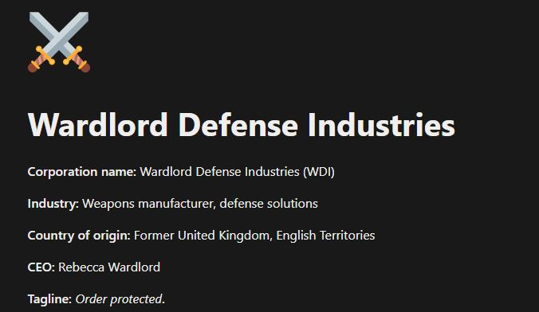
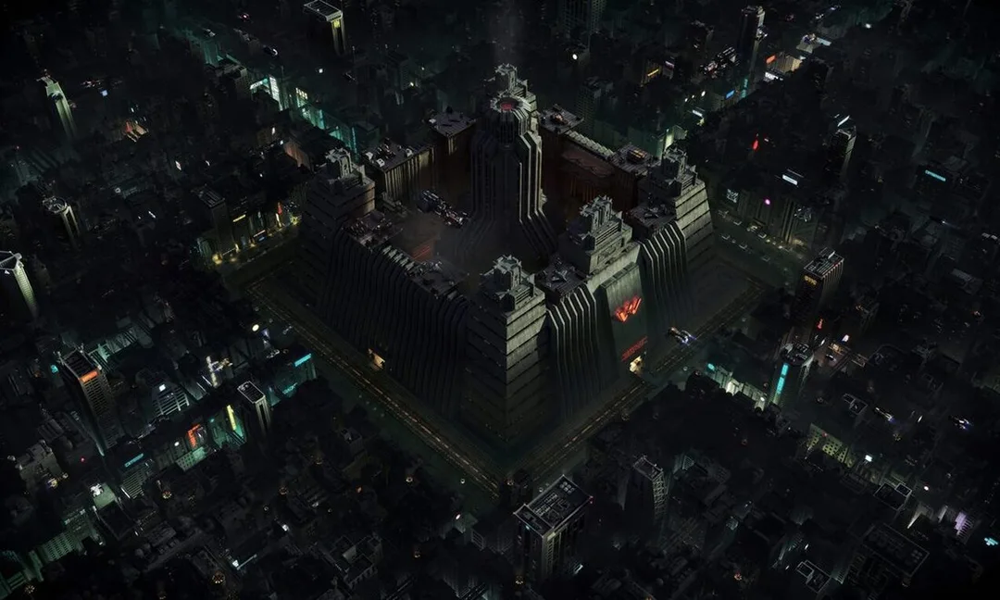
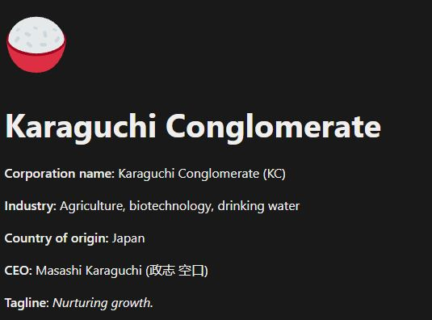
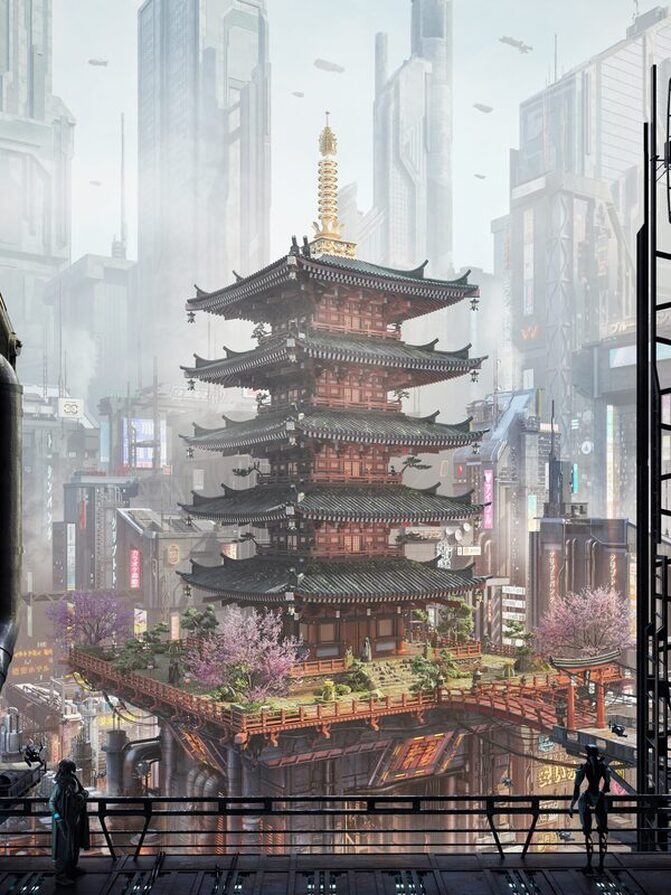
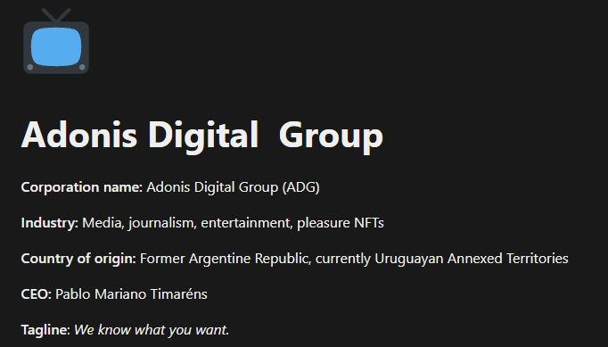
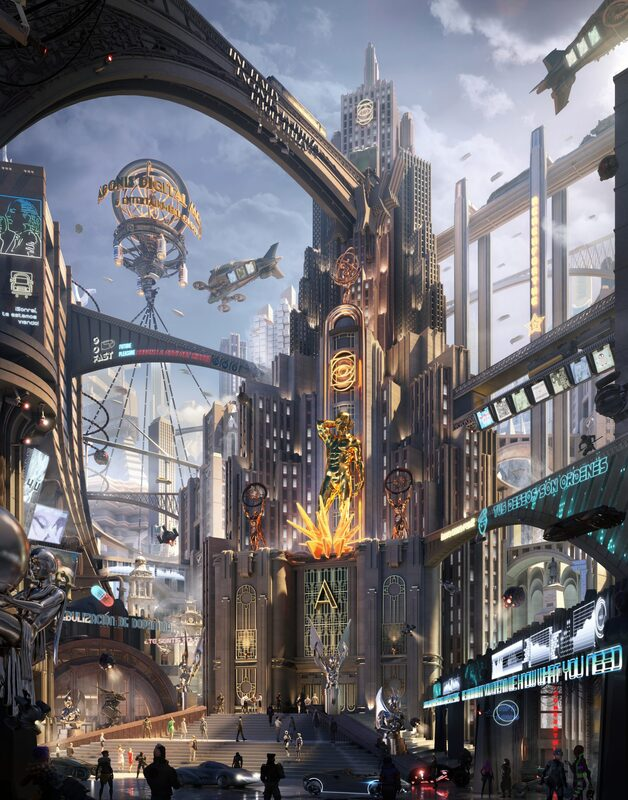
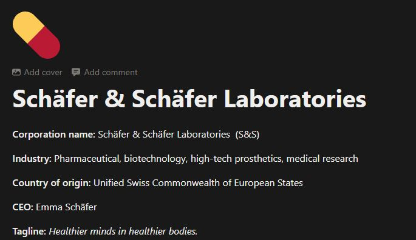
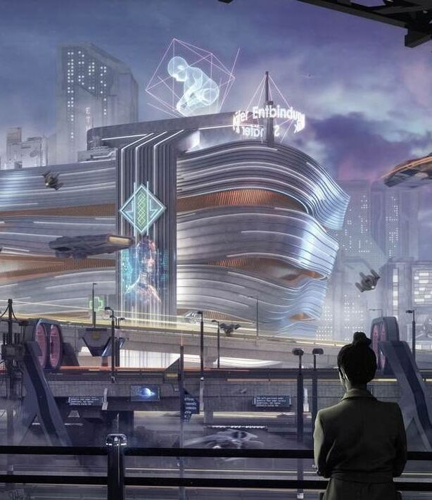
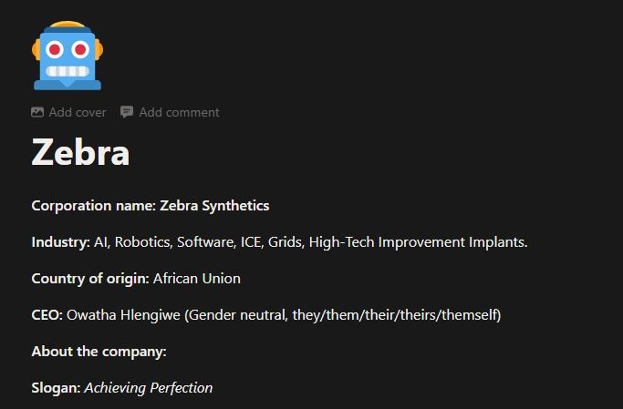
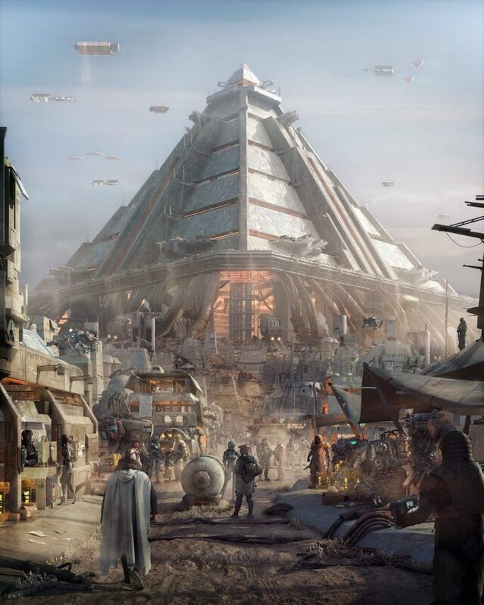

En la entrada anterior conté que todavía no sabíamos para qué se iba a usar el mundo que estábamos construyendo, pero que teníamos bastante claro qué elementos necesitaba. Fuera cual fuese el producto que termináramos haciendo, iba a ser cyberpunk, con cinco megacorporaciones que gobernaban un futuro distópico y cinco facciones de hackers que se les oponían. Esa distribución no era arbitraria: cinco de cada una nos daba variedad y margen tanto para la narración como para el diseño de la experiencia, sin diluir demasiado la atención del público.

Y esa decisión no la tomé yo solo. Fue conversada y acordada por mí, como diseñador narrativo, y los fundadores de **Flatline Studios**, como los “stakeholders” del proyecto. Esa última palabra puede sonar fría y corporativa, lo opuesto de lo que buscamos en una tarea creativo, pero creo que es la correcta: un stakeholder es alguien con un interés directo en el éxito de una actividad. ¿Y quién tiene más interés en mi trabajo que las personas que me contrataron para hacerlo? Mantenerlos involucrados me dio rumbo y algo de tranquilidad. A mí me gusta medir diez veces y cortar una, en vez de medir una vez y cortar diez. Confirmar con ellos que las bases del world-building coincidían con lo que tenían en mente (o que, al menos, eran algo distinto pero igual de aceptable) significaba que mi tiempo y mi esfuerzo no se estaban desperdiciando. Y como éramos (y seguimos siendo) un equipo chico al que le importaba que todos se sintieran libres de opinar sobre todo, el proceso entero estuvo lleno de momentos como “¿qué te parece que estaría bueno incluir en nuestro mundo?” o “esto es lo que me encantaría incorporar de alguna manera”. Mirando hacia atrás, no siempre puedo decir quién sugirió qué primero: las ideas pasaban por tantas manos en esas sesiones que prefiero darle el crédito al equipo antes que adivinar.

Entonces: cinco facciones de hackers y cinco corporaciones antagonistas. Ya habíamos definido qué teníamos que construir; ahora me tocaba construirlo. Empecé por las corporaciones, haciéndome las preguntas que parecían relevantes desde ese punto de partida. En este mundo distópico gobernado por corporaciones, ¿cuáles concentrarían más poder? Quería que fueran igual de fuertes, para que pudieran cooperar o competir según lo necesitara la narrativa. Eso implicaba darle a cada una una industria bien diferenciada, de modo que pudieran dominar distintos aspectos del mundo.

Me pregunté: “¿Qué tipo de empresas gobernarían el futuro?” Como este proyecto trataba de un futuro ficticio no tan lejano, miré mi presente. La guerra me pareció una industria perenne: siempre de moda, siempre vigente, siempre turbia, siempre moviendo los hilos desde atrás de la cortina. Las armas, las municiones y la seguridad privada, entonces, tenían que estar en el corazón de una de nuestras megacorporaciones: un gigante militarista y belicista. Una menos, faltan cuatro.

La siguiente me resultó obvia: el sustento de la vida, la comida y el agua. Pero me costaba imaginar una empresa que controlara la comida y el agua a nivel mundial (ya sé, qué ingenuo). Necesitaba un evento, o varios, que cambiasen cómo se producían la comida y el agua a escala global. Así que acordamos esto: en algún momento del pasado, un fenómeno climático indeterminado había envenenado la mayor parte del agua y vuelto inviable el cultivo, y algún otro suceso vago había sacado al ganado de la ecuación. Los detalles podían esperar. Creo que imaginar primero un escenario narrativo y trabajar hacia atrás hasta su justificación puede ser una estrategia válida, siempre que tengas la seguridad de que lo que estás creando en el espacio negativo no hace agua. ¿Y cómo llegó esta empresa a tener el monopolio de la comida y el agua? Estábamos construyendo un mundo de ciencia ficción, así que nos apoyamos en eso: la empresa sería dueña de la tecnología privativa para imprimir carne, purificar agua y cultivar alimentos hidropónicos. Eso mantendría al mundo comiendo de su mano, en sentido figurado y un poco literal.

La primera empresa era la violencia; la segunda, el sustento. ¿Y la tercera? Los medios parecían un candidato fuerte, y una empresa que moldeara la opinión pública a través de la propaganda me pareció una versión más explícita de la realidad actual. Entonces: un medio de noticias, un canal de streaming con esteroides, transmisiones en vivo vistas por decenas de millones de personas cada noche, programas tan populares que definían elecciones (si es que la democracia todavía existía en 2112). Ofrecería un suministro interminable de humor berreta y de gente holográfica con poca ropa, algo que la población adormecida de nuestro mundo pudiera consumir a diario para sobrellevar mejor vivir en una pesadilla de ciencia ficción. Además, nos pareció buena idea hacer de esta empresa la dueña de una plataforma de redes sociales masiva, usada por el 90% del mundo, para dejar en claro que esta entidad comercial podía torcer la verdad a voluntad y que su alcance era casi omnipresente.

Con eso ya eran tres. Durante nuestras sesiones de trabajo habíamos hablado de usar las megacorporaciones para mostrar cuán futurista queríamos que fuera nuestro mundo, y una de las cosas que a todos nos encantaban de la ciencia ficción eran los implantes: modificaciones cibernéticas del cuerpo humano. Así que decidimos ampliar ese alcance a una empresa farmacéutica (supongo que desarrollar esto mientras el COVID todavía era un tema central también influyó). Los implantes de alta tecnología, las mejoras corporales y todo tipo de drogas premium quedarían bajo su órbita, junto con experimentos ilegales en humanos y más.

La última empresa tenía que estar sí o sí. Si estábamos construyendo un mundo cyberpunk, ¿dónde estaban los robots? Así que decidimos que una sola empresa dominara todo lo relacionado con androides, inteligencia artificial y software. Eso le dio a nuestro mundo cierta uniformidad y cohesión en su avance tecnológico, y convirtió a la tecnología no solo en parte de cada corporación, sino en el motor de una en particular.

Entonces, cinco megacorporaciones algo en sosas y genéricas: armas y seguridad; comida y agua; medios y entretenimiento; farmacéutica e implantes; y software y robótica. Dicho así quizás no parezca mucho, pero esos huesos eran lo bastante fuertes como para empezar a ponerles carne encima. Yo me había preguntado qué tipo de corporaciones gobernarían el mundo que estábamos construyendo, y ahora tenía una respuesta, lo que me habilitaba a meterme en los detalles. ¿Dónde, por ejemplo, tendrían sus sedes? Como equipo, tomamos decisiones guiadas no solo por nuestros deseos creativos, sino también por ciertas intuiciones comerciales que nos parecía que merecían consideración. Por ejemplo, decidimos mantenernos lejos de las superpotencias geopolíticas de nuestra época: ninguna de nuestras megacorporaciones tendría su base en los Estados Unidos de América, Rusia o China, y ni siquiera está confirmado que esos países existan en nuestra visión del año 2112. ¿Por qué? Principalmente, porque nos divertía imaginar un mundo en el que esos actores ya no fueran tan relevantes, y hacerlo abría muchas posibilidades narrativas. Pero había otra razón: a algunas personas podría molestarles que los héroes o los villanos sean de su país, o de una versión ficticia de él. Pensamos que no meternos con algunos países podría ayudarnos a evitar ese efecto, al menos con los más grandes. A partir de ahí, nos tomamos algunas libertades al dibujar el mapa de nuestro universo.

Disolvimos el Reino Unido y lo reemplazamos por los Territorios Ingleses, ubicando a nuestra empresa belicista en la recién creada Ciudad Autónoma del Gran Londres. Su historia como superpotencia naval y colonial, junto con algunas críticas personales mías a esa historia, justificó la decisión.

La mayor parte del equipo de desarrollo, yo incluido, es argentina, y queríamos incluir nuestro país. Pero, como lo escribí yo, opté por la autoburla, y lo llamé los Territorios Anexados Uruguayos, insinuando que ya no existía un país llamado Argentina después de haber sido invadido por nuestros vecinos del noreste. Esa ubicación fue para nuestra megacorporación de medios.

Otra decisión fue convertir todo el continente africano en un solo país llamado la Unión Africana. Algunos lectores podrían encontrarlo reprochable, o señal de un world-building perezoso, ya que pasa por alto las diferencias sutiles y no tan sutiles entre los pueblos que conformarían una entidad geopolítica tan rica. No voy a decir que esa lectura sea imposible, y si es cierta, la responsabilidad es mía. Lo que sí voy a decir es que fue una decisión tomada con intención. Como habíamos decidido no copiar en nuestro producto la configuración geopolítica del mundo de 2020, teníamos margen para ubicar los centros de poder donde quisiéramos o necesitáramos, y creo que es difícil no mostrar algo de las propias opiniones y deseos en el trabajo de uno. Reconozco cierta ingenuidad política adolescente en la idea de un continente que alguna vez estuvo casi enteramente colonizado consolidando una unión y convirtiéndose en uno de los pesos pesados en la disputa por el poder global. Lo hubiera escrito para mi propio continente, Sudamérica, pero incluso sabiendo que estaba escribiendo ciencia ficción, eso me pareció un poco demasiado forzado. Así que la ciudad inventada de Mwandez, capital de la Unión Africana, se convirtió en la sede de poder de la megacorporación de robótica y software más importante de nuestro universo narrativo.

También erosioné a los países europeos y los fusioné en la Mancomunidad Suiza Unificada de Estados Europeos, así que no es que haya tenido mucho cuidado de preservar la identidad en otros lados. El razonamiento era sencillo: tener una de nuestras megacorporaciones en un área de habla alemana era bueno para la nomenclatura, porque me permitía ponerles nombres en alemán a las cosas, que suenan distintos y únicos y ayudab con la marca de empresas ficticias. Y por razones históricas, no iba a convertir a Alemania en el superestado que liderara Europa. Así que la sede de nuestra empresa farmacéutica terminó en Suiza.

Después de ubicar megacorporaciones en Inglaterra, Sudamérica, África y Europa continental, todos sabíamos más o menos qué venía: Asia. ¿Por qué? Por muchas razones. Buena parte de la imaginería cyberpunk tiene un aire asiático, desde los carteles de neón y los puestos callejeros de fideos de **Blade Runner** hasta **Akira**, de Katsuhiro Ōtomo. Muchas de las cosas que amábamos de la ciencia ficción combinaban tecnología de punta con culturas milenarias e ideogramas holográficos. Decidí ubicar a nuestro coloso de comida y agua en Japón, principalmente porque había estado una vez en Japón y entendía algo del idioma, lo que pensé que serviría para la nomenclatura y la estética.

Para recapitular: empezamos sabiendo que necesitábamos cinco megacorporaciones y nada más. Definimos sus industrias, después les asignamos ubicaciones, empezando por lo general y yendo hacia lo específico. Estábamos lejos de terminar, porque todavía nada tenía nombre ni historia, pero lo que antes era oscuridad total se había vuelto formas borrosas y se iba convirtiendo en figuras más definidas. Para mí, el trabajo suele ser exactamente eso: empezar por lo general y llegar a lo específico. Identificás una idea amplia de lo que querés o necesitás desde lo narrativo, y después le hacés a esa idea las preguntas correctas hasta llegar a formas y colores que cumplan la necesidad inicial y que además sean interesantes y divertidos para contar historias.

Tomemos nuestra empresa militar. Inglaterra tiene una larga historia de guerras, desde la época medieval hasta la Segunda Guerra Mundial, así que recurrimos a ese trasfondo e imaginamos a una única familia que llevaba generaciones haciendo dinero con el derramamiento de sangre. Llamamos a la familia Wardlord y a la corporación **Wardlord Defense Industries** (WDI). Voy a hablar más a fondo de nombres y nomenclatura en una entrada futura, pero este es bastante obvio: “Wardlord” suena como “warlord” (señor de la guerra), pero el verbo inglés *to ward* también significa “proteger”. No queríamos megacorporaciones chatas que se proclamasen malvadas porque sí; queríamos darles un propósito. WDI estaba “protegiendo el orden”, y las personas que trabajaban ahí creerían, sin ninguna duda, que estaban haciendo un buen trabajo, protegiendo a quienes no podían defenderse, aunque eso implicara restringir derechos básicos o causar algunas muertes colaterales. Ese contraste entre señores de la guerra y guardianes del orden nos resultó lo bastante divertido, como desarrolladores, como para que pasara a ser parte de nuestra filosofía de world-building: el público se identificaría con los hackers, así que los adversarios corporativos tenían que ser fáciles de enfrentar y, al mismo tiempo, conservar una imagen de sí mismos como decentes o con un propósito legítimo. Escribí un poco de lore de WDI, sobre cómo los Wardlord vendían armas y armaduras desde la Edad Media y cómo eso se convirtió en la corporación militar de 2112. Con eso alcanzaba por el momento.


  
  


*De izquierda a derecha: captura de pantalla de un documento de diseño de WDI, representación artística de la casa matriz de WDI.*

Para nuestra empresa japonesa de comida y agua, escribí la historia de un químico japonés que desarrolló un nuevo método para purificar agua e imprimir carne sintética. Llamamos a la empresa **Karaguchi Conglomerate** (KC), por el apellido de su fundador. En japonés, “kara” puede significar “vacío” (から, 空), y “guchi” puede sonar como la palabra para “boca” (くち, 口), así que “boca vacía” me pareció un apellido adecuado para alguien que no solo producía comida, sino que además dejaba morir de hambre a la gente al ser el único dueño de ese monopolio. La empresa sería responsable de alimentar a buena parte del mundo, así que su existencia tenía un impacto positivo innegable. Para darle algo de picante a su lore, sin embargo, KC también usaría su control de la comida y el agua para obligar a los países a cierto grado de sumisión. Esa actitud vendría de la creencia genuina de que solo ellos estaban capacitados para semejante responsabilidad, una creencia encarnada en el nacionalismo de su liderazgo, y su efecto directo sería que KC consideraba a cualquiera por fuera de su estructura interna como inferior e indigno de tomar cualquier decisión relevante.


  
  


*De izquierda a derecha: captura de pantalla de un documento de diseño de KC, representación artística de la casa matriz de KC.*

Después vino el medio de comunicación, la máquina de propaganda, que habíamos ubicado en Argentina. Como ese era el hogar de la mayoría de los desarrolladores, quisimos divertirnos un poco con eso. En su centro había un personaje ficticio, una combinación de varias figuras reales de la televisión y la cultura argentinas: un hombre que venía de la pobreza y que, a puro carisma y ambición, construyó el programa de entretenimiento número uno del planeta. Inspirado en los medios argentinos con los que crecí, su programa era un espectáculo de horario central construido sobre el humor y la explotación sexual, donde la gente o contaba chistes verdes o exhibía su cuerpo. Es mi crítica a la programación de mi infancia. Las personas que atraviesan épocas difíciles suelen mirar a las figuras del entretenimiento como algo esencial en sus vidas, y eso tiene sentido: después de un día de trabajo agotador en una sociedad cada vez más decadente, una hora de programa divertido es escapismo, y quizás uno muy necesario. Pero si quien provee ese escapismo sabe que su trabajo solo adormece a la audiencia y la mantiene dócil, en lugar de usar su plataforma para impulsar un cambio positivo, bueno, quizás haya algo cruel en un conductor así, más aún si puede ser comprado para influir en los espectadores a voluntad. Decidimos no ponerle a la empresa el nombre de un fundador, solo para cambiar un poco las cosas, pero como tenía ese espíritu superficial y esa obsesión con los cuerpos, la bautizamos **Adonis Digital Group** (ADG) y le dimos la mayor parte del streaming y las redes sociales de nuestro universo narrativo.


  
  


*De izquierda a derecha: captura de pantalla de un documento de diseño de ADG, representación artística de la casa matriz de ADG.*

Después llegó nuestra empresa farmacéutica de aire germánico. La idea era algo con diéresis, y la tentación de ponerle a una corporación médica el mismo apellido dos veces seguidas era demasiado fuerte para resistirse, así que nació **Schäfer & Schäfer Laboratories** (S&S). Pero ¿quiénes eran los Schäfer detrás de semejante emporio de drogas? Serían dos hermanas gemelas: una investigadora médica responsable de un gran avance científico, la otra la experta en negocios. Después decidimos que tener dos fundadoras para una sola empresa era quizás excesivo, así que una de las hermanas desapareció misteriosamente, lo que simplificó el organigrama y dejó disponible, para más adelante si hacía falta, el recurso de la “gemela desaparecida”. Eso dejó a la otra hermana: una mujer paranoica, adicta a su propia marca de drogas, que guardaba un secreto siniestro y estaba dispuesta a hacer pruebas brutales en humanos para aumentar las ganancias de la empresa.


  
  


*De izquierda a derecha: captura de pantalla de un documento de diseño de S&S, representación artística de un hospital de Schäfer & Schäfer.*

Para nuestra corporación africana de software y robótica, la idea era probar algo distinto. Hasta ese momento, todas las empresas que habíamos diseñado las había fundado una persona o una familia que seguía dirigiéndolas en nuestro presente narrativo. Pensamos que podía ser interesante explorar una empresa creada por una persona y heredada por otra. La corporación se concibió como la obra de una programadora brillante que había usado todo su talento para construir robots e inteligencias artificiales que asistieran a la humanidad. Ella moriría en circunstancias poco claras y dejaría la empresa en manos de la persona a la que había formado, cuyas intenciones eran bastante más oscuras que las suyas: el deseo de transformar la propia conciencia en software y eliminar la necesidad de los cuerpos humanos. El escenario africano y mi amor por los estampados animales nos llevaron a acordar el nombre **Zebra Synthetics** (ZS) para nuestra megacorporación de robótica.


  
  


*De izquierda a derecha: captura de pantalla de un documento de diseño de ZS, representación artística de la casa matriz de Zebra Synthetics.*

Nuestras megacorporaciones ahora tenían mucha más sustancia. Como documento de diseño, escribí algo parecido a una entrada enciclopédica para cada corporación, con todo lo que habíamos decidido sobre ellas (pongo las versiones publicadas en los enlaces de más abajo). Estas entradas consolidaban el producto de nuestras sesiones de trabajo, reuniendo en un solo lugar todo lo que habíamos discutido en equipo sobre las corporaciones. También servían de referencia, primero para mí y después para cualquier otra persona del equipo artístico, como quienes diseñaban personajes o componían la música: cualquiera que necesitara una idea de cómo eran las corporaciones de nuestro mundo iba a encontrar todo lo que pudiéramos darle. Esta es la versión rápida:

- [**Wardlord Defense Industries**](https://www.flatline.games/wdi) era un fabricante de armas centenario, con un impulso fascista por el orden a cualquier costo.
- El [**Karaguchi Conglomerate**](https://www.flatline.games/kc) resultó ser un proveedor de alimentos despótico, sin ningún problema en dejar sin comer a quienes no siguieran su liderazgo.
- [**Adonis Digital Group**](https://www.flatline.games/adonis) se convirtió en una máquina de propaganda que o bien le servía a su audiencia chistes berretas y desnudos, o bien torcía la realidad para fabricar opinión pública.
- [**Schäfer & Schäfer Laboratories**](https://www.flatline.games/schafer) salió como una farmacéutica de vanguardia dispuesta a destruir la salud de muchos para mejorar la calidad de vida de unos pocos.
- [**Zebra Synthetics**](https://www.flatline.games/zebra) empezó como una organización compasiva que promovía el avance científico, pero ahora estaba bajo una gestión más sombría.

Estábamos conformes con el lugar al que habían llegado nuestros antagonistas. Pero ¿y nuestros protagonistas? ¿Qué sabíamos de los hackers? Solo que tenían que ser cinco. También sabíamos que el origen geopolítico no era importante para las facciones de hackers: como toda buena resistencia clandestina, tenían que estar en todas partes y en ninguna a la vez. Eso nos dejaba libres para concentrarnos en la estética y en las motivaciones narrativas como quisiéramos.

La primera facción tenía que ser la base, la de vainilla. Como alguien que ama los sabores de vainilla, entendí que tenía que ser simple pero igual interesante. Después de algunas sesiones de trabajo, decidimos que esta facción estaría formada por mercenarios: hackers que solían trabajar solos pero también podían armar equipos para completar contratos. Cuando surgió la idea de trabajar solo contra trabajar en equipo, algo hizo clic desde lo lingüístico. A quienes trabajan solos se los puede llamar “lobos solitarios”, y la referencia animal nos quedó. Quizás lo opuesto a esos lobos solitarios eran hackers que andaban en manada. También habíamos hablado de hacer de esta la facción más abierta, a la que cualquiera podía unirse si no tenía otro lugar adonde ir. Consideramos todo eso y nos decidimos por un nombre que mantuviera la idea animal, ya que los perros pueden ser solitarios o andar en manada, y que además les quedara bien a quienes no tenían otro lugar adonde ir: los [**Stray Dogs**](https://www.flatline.games/thestraydogs) (algo así como “perros callejeros” en inglés). Su mentalidad general sería el impulso de ser los mejores en su oficio, y su estética sería áspera y muy gastada, señal de experiencia y de una necesidad constante de adaptarse a lo que tuvieran a mano. Igual que con las corporaciones, y con cada facción posterior a esta, escribí su entrada de referencia.


  
  


*De izquierda a derecha: captura de pantalla de un documento de diseño de los Stray Dogs, representación artística de un hacker Stray Dog.*

Para la segunda facción, queríamos un grupo de hackers streamers e influencers. En mi cabeza, serían algo así como Banksy mezclado con el Project Mayhem de **Fight Club**: borrarían los centros de datos de instituciones financieras para eliminar la deuda de las masas, todo mientras lo transmitían y se aseguraban de que se viera estéticamente sublime. Trabajamos en este concepto bastante tiempo antes de descartarlo, y la verdad es que todavía respaldo esa decisión. Yo pensaba: ¿una facción entera de hackers que no solo ataca con éxito a las corporaciones sino que lo transmite, y a la que casi nunca atrapan? ¿Qué tan buenos son estos hackers? ¿O nuestras corporaciones son completamente inútiles para defenderse? Si estos hackers podían hacer todo eso, eran o bien demasiado poderosos o bien sus oponentes eran inofensivos, y ninguna de las dos cosas es buena para el world-building. Ambas hacen que el riesgo de que ganen los antagonistas sea casi inexistente, y justificarlo narrativamente era un problema.



Así que le pegué un tiro a esa idea, porque era mi responsabilidad decir: “Sé que queremos que esto funcione, pero no está haciendo lo que necesitamos, y va a ser un problema más grande más adelante”. Muchos de los conceptos de esta facción habían venido de integrantes del equipo más arriba en la cadena de mando, y aun así confiaron en mí y me dieron luz verde para volver a empezar de cero y hacer algo distinto, igual de interesante pero menos problemático. La nueva versión conservó el espíritu de hackers que querían hacer cosas con belleza, y la idea de compartir con otros, pero con un giro: serían defensores del copyleft y campeones de la libertad de información. Lo que compartirían seróa conocimiento, y si en el curso de sus actividades ciberterroristas deslumbraban a otros hackers con la sofisticación de los programas que escribían o las máquinas que construían, que así fuera. Lo mantuvimos simple y los llamamos los [**Makers**](https://www.flatline.games/themakers) (algo así como "hacedores" en inglés), con un aire general de gente que vive armando y desarmando cosas.


  
  


*De izquierda a derecha: captura de pantalla de un documento de diseño de los Makers, representación artística del concepto actualizado de los Makers.*

Después, queríamos una organización criminal en serio. Todos los hackers son criminales, pero nosotros queríamos algo más al estilo **John Wick**: una sociedad secreta de clase alta. Su espíritu sería la lealtad: los miembros serían reclutados muy jóvenes y recibían acceso a todos los recursos de la organización, y a cambio cumplían cualquier encargo que les dieran. Tendría una jerarquía vertical clara y una estética lujosa y refinada. Como queríamos una amalgama de todas las organizaciones criminales conocidas del mundo, necesitábamos un nombre lo bastante flexible como para abarcar muchas afiliaciones. Coincidimos todos en el [**Guild**](https://www.flatline.games/theguild) (algo así como “el gremio” en inglés). En mi cabeza iba por el lado del Thieves' Guild de **The Elder Scrolls** y de la película **Payback**, de 1999, y recuerdo que otros integrantes del equipo lo asociaban con otros grupos, como el Syndicate de **Android: Netrunner**.


  
  


*De izquierda a derecha: captura de pantalla de un documento de diseño del Guild, representación artística de un miembro del Guild.*

Para nuestra cuarta facción, queríamos un objetivo realmente simple pero contundente: rebelarse. Imaginamos hackers convencidos de que estaban haciendo lo correcto, no por dinero, ego o gloria, sino porque creían que enfrentarse a los opresores debería ser lo natural para cualquiera. También le dimos a esta facción la postura más antitecnológica de todas. Seguirían siendo muy cyberpunk, pero pensamos que el tópico de “preservar nuestra humanidad” podía encontrar un buen hogar en algunos de sus miembros. Como el concepto resultaba bastante clásico, los llamamos los [**Punks**](https://www.flatline.games/thepunks), y decidimos que su estética sería una versión más futurista del look punk estereotípico: implantes cibernéticos con forma de cresta que cambian de color según el humor de quien los lleva, ese tipo de cosas. Era lo bastante clásico como para reconocerse al instante, pero también futurista y de ciencia ficción.


  
  


*De izquierda a derecha: captura de pantalla de un documento de diseño de los Punks, representación artística de un hacker Punk.*

Por último, queríamos algo más extravagante: una facción que ofreciera lo opuesto a lo que los Punks proponían respecto de “preservar la humanidad”. Queríamos hackers muy cómodos con los implantes pesados, con mucho cromo y cables saliéndoles de la cabeza. Trabajamos mucho esta facción en grupo, y muchas de sus ideas centrales no fueron diseño mío, solo ejecución mía. A veces eso fue muy enriquecedor; otras veces, fue fuente de conflicto entre lo que el equipo quería que tuviera la facción y lo que yo, como diseñador narrativo, pensaba que tenía sentido y funcionaría mejor a largo plazo.

Este era el problema. Habíamos decidido que el gusto de esta facción por los implantes y las modificaciones estaría atado a un deseo de alcanzar algún conocimiento superior y secreto, y, como estábamos en 2112, decidimos que creyeran estar en contacto con una raza alienígena. Tendría que haber algo de sustancia en esa afirmación. Algunos integrantes del equipo tenían un deseo genuino y válido de que los alienígenas aparecieran de verdad, porque sería divertido y podría justificar avances tecnológicos que de otro modo se sentirían fuera de lugar. Yo quería preservar la ambigüedad a toda costa. ¿Por qué? Porque los alienígenas confirmados eclipsarían cualquier otro tema de conversación. Pensaba, y sigo pensando, que estábamos construyendo una versión más sombría de nuestro propio mundo, más adelante en el camino, donde temas como la codicia, la compasión, el poder y la libertad todavía tenían lugar y podían explorarse a través de nuestro marco de ciencia ficción. Confirmar que los alienígenas eran reales me parecía que iba a socavar esos temas.

Trabajamos mucho en cómo estos hackers se contactarían con los alienígenas, qué órdenes recibirían y qué jerarquía tendrían. Gran parte de eso terminó recortada, modificada o simplemente marcada como “lo vemos más adelante” (más sobre eso en una entrada futura), pero el concepto de un grupo de hackers muy modificados y obsesionados con la existencia de alienígenas era lo bastante sólido como para conservarlo, aunque no coincidiéramos en todos los detalles. Volvimos a **Rush** para el nombre de la raza alienígena, los Syrinx. Si no escuchaste **The Temples of Syrinx**, yo lo recomiendo; creo que es una de mis favoritas de la banda. Para los hackers en sí, como queríamos que fueran enigmáticos y misteriosos, elegimos el nombre [**Cyphers**](https://www.flatline.games/thecyphers)(algo así como "los cifrados" en inglés).


  
  


*De izquierda a derecha: captura de pantalla de un documento de diseño de los Cyphers, arte conceptual de un hacker Cypher.*

Toda esta parte del proceso de diseño tomó una necesidad narrativa (“necesitamos cinco megacorporaciones distintas y cinco facciones de hackers distintas”) y la fue volviendo cada vez más específica hasta que se sintió sólida e interesante. Me gusta pensarlo como la forma en que se cargaban las imágenes en las computadoras muy viejas, en varias pasadas: primero un borrón, cada vez más nítido con cada una. Empezamos con trazos muy gruesos y fuimos sumando detalle hasta que quedamos conformes con el resultado.

Mirando para atrás, creo que hicimos un buen trabajo priorizando lo que nosotros, como equipo, necesitábamos que fuera el producto, dejando lugar para los deseos y gustos individuales. Después de todo, a todos nos importaba que nos gustara lo que estábamos construyendo, y eso no es poca cosa. Como mencioné en la entrada anterior, yo no había propuesto este proyecto, me habían invitado a participar de él, así que acomodar los deseos de otros stakeholders y a la vez asegurarme de que mi diseño narrativo se sostuviera me importaba mucho: mi trabajo está impregnado de cómo me siento con él, y si odio el proceso probablemente odie el producto. Sentirme bien con las decisiones que tomamos como equipo, y con la manera en que las tomamos, mejoraba mis posibilidades de no vivir el trabajo como una carga. Estoy seguro de que tener en cuenta los aportes de mis compañeros, y esforzarme por encontrar la mejor manera de incorporarlos a nuestro mundo, también los hizo sentirse mejor con el proyecto.

Lamento decir que no siempre lo logré, y que a veces no me esforcé lo suficiente. Yo tenía mi propia visión de lo que era un buen world-building, y a veces las ideas de los otros simplemente no encajaban ahí. Me gusta creer que nunca puse mis caprichos por sobre el mejor interés del proyecto, pero seguramente fui demasiado vehemente en ocasiones, y esa actitud erosionó parte de la alegría que mis compañeros podrían haber encontrado en ser parte del proceso de diseño narrativo. Se los reconocí y les pedí disculpas, y lo que puedo hacer ahora es mantenerme atento a cuán fácil o difícil les resulta a los demás participar en un proceso que es tan de ellos como mío.

Y en esa línea, acompañame en la próxima entrada, donde voy a hablar con más detalle de las herramientas que armé para que mis compañeros pudieran participar activamente en el diseño de nuestros primeros personajes completamente desarrollados: los CEO de nuestras megacorporaciones.
