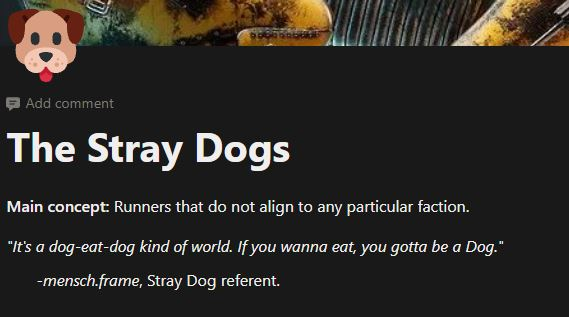
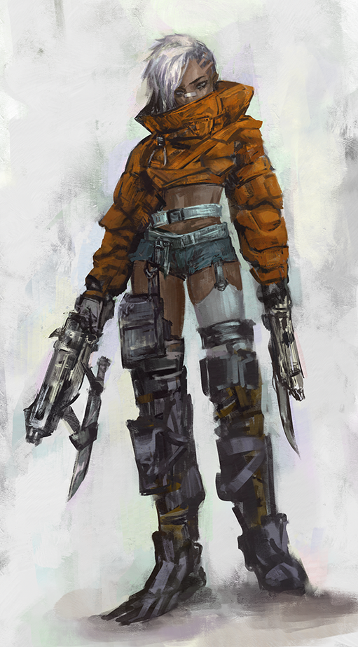
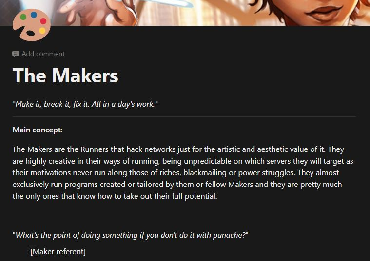
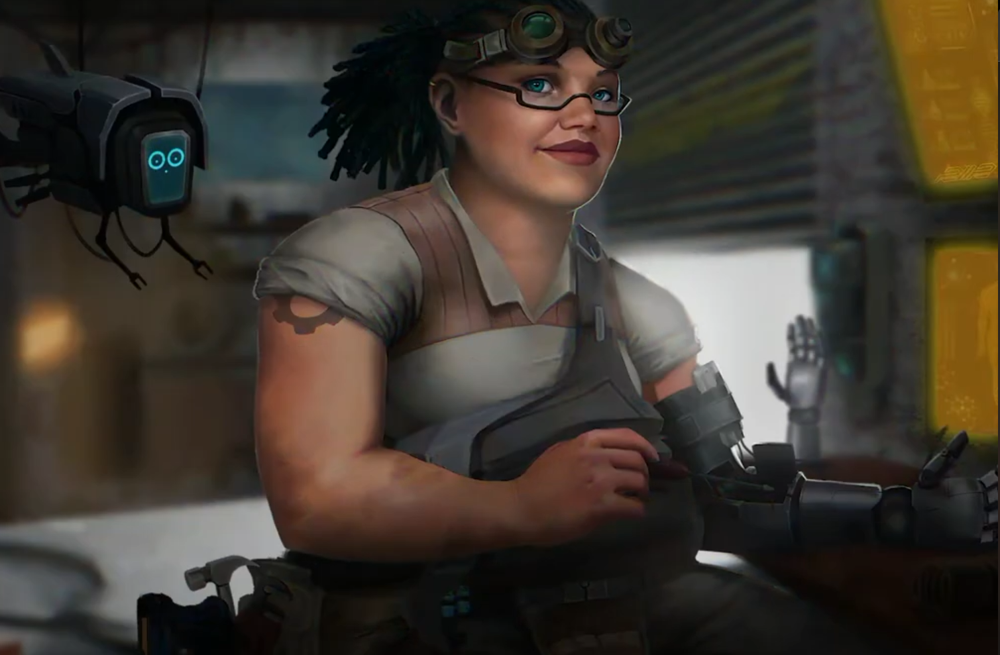
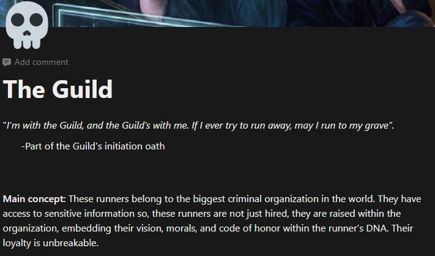
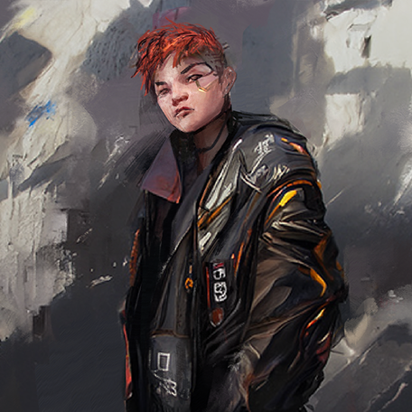
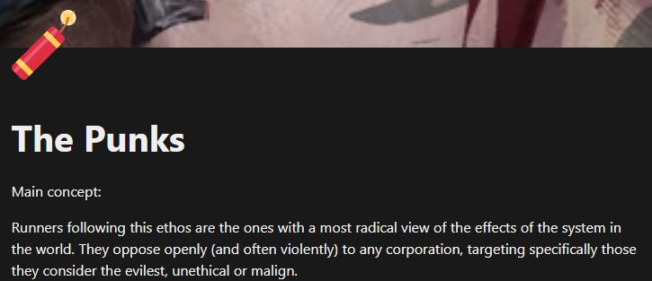
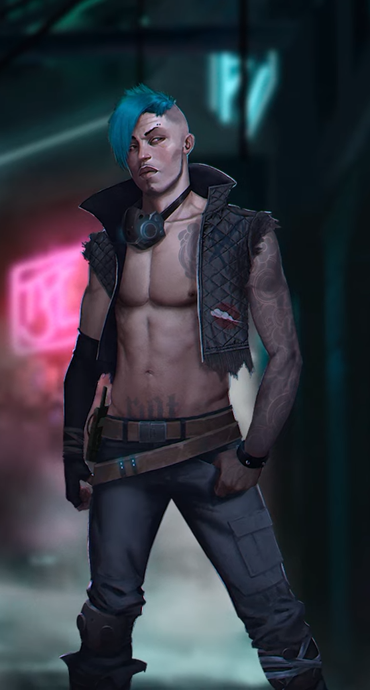
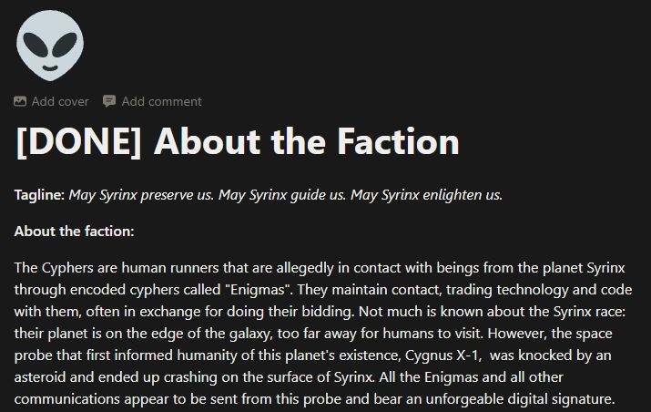
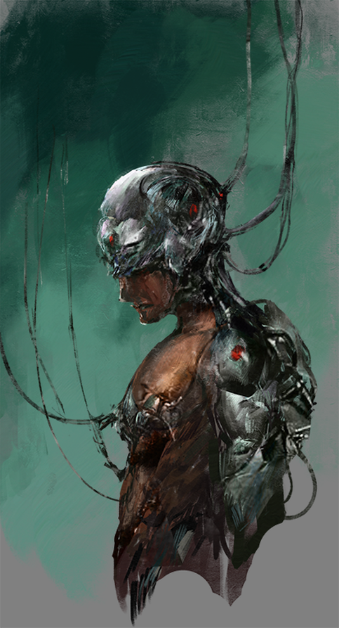

After working the megacorporations from blurry images to somewhat well-defined players in our narrative universe, we needed to apply the same process to what we knew would be the playable characters, the hackers, the protagonists. What did we know about the factions those hackers belonged to? Only that there had to be five. We also knew that geopolitical origin wasn't important for the hacker factions: like any good illegal resistance, they had to be everywhere and nowhere at once. That left us free to focus on aesthetics and narrative motives as we pleased.

The first faction was meant to be the base, the vanilla one. As someone who loves vanilla flavours, I took that to mean it had to be simple but still interesting. After some work sessions, we decided this faction would be made up of mercenaries: hackers who usually worked alone but could also form teams to complete contracts. When the idea of working alone versus working in teams came up, something clicked from a language perspective. People who work alone can be called "lone wolves", and the animal reference stuck with us. Maybe the opposite of these lone wolves were hackers who ran in packs. We had also discussed making this the most welcoming faction, the one anybody could join if they had nowhere else to go. We considered all of that and settled on a name that kept the animal idea, since dogs can be loners or run in packs, and that also suited those with nowhere else to go: the [**Stray Dogs**](https://www.flatline.games/thestraydogs). Their general mindset would be a drive to be the best at their craft, and their aesthetic would be rough and heavily worn, signalling experience and a constant need to adapt to whatever they had on hand. As I mentioned I did with the corporations in the previous entry, and with every faction after this one, I wrote their reference entry.


  
  


*Left to right: Screenshot of a design document for the Stray Dogs, artist's rendition of a Stray Dog hacker.*

For the second faction, we wanted a group of hacking streamers and influencers. In my mind, they would be something like Banksy meets the Project Mayhem part of **Fight Club**: they would wipe the data centres of financial institutions to erase the masses' debt, all while streaming it and making sure it looked aesthetically superb. We worked on this concept for quite some time before dropping it, and in all honesty, I stand by that decision. Think about it: a whole faction of hackers that not only successfully attacks corporations but broadcasts it, and isn't consistently caught? Just how good are these hackers? Or are our corporations completely useless at defending themselves? If these hackers could do all that, they were either overpowered or their opponents were toothless, and neither is good for world-building. Both make the risk of the antagonists winning almost non-existent, and justifying it narratively was a problem on top of that.



So, I took that idea out back and shot it, because it was my responsibility to say, "I know we want this to work, but it isn't doing what we need it to do, and it will be a bigger problem down the line." A lot of the concepts for this faction had come from team members higher up the chain of command, yet they trusted me and gave me the green light to go back to square one and do something different that was still interesting but less problematic. The new version kept the spirit of hackers who wanted to make things beautifully, and the idea of sharing with others, but gave it a spin: these hackers would be copyleft advocates and champions of freedom of information. Knowledge is what they would share, and if, in the course of their cyberterrorist activities, they happened to dazzle other hackers with the sophistication of the programs they coded or the machines they built, so be it. We kept it simple and named them the [**Makers**](https://www.flatline.games/themakers), with a general tinkerers' vibe.


  



*Left to right: Screenshot of a design document for the Makers, artist's rendition of the updated concept for the Makers.*

Next, we wanted a proper criminal organisation. All hackers are criminals, but we wanted the more **John Wick**, high-class, secret-society type. Its spirit would be loyalty: members would usually be taken in very young and given access to all the organisation's resources, and in exchange they would carry out any assignment they were given. It would have a clear vertical hierarchy and a luxurious, refined aesthetic. Because we wanted an amalgam of every known criminal organisation in the world, we needed a name flexible enough to encompass many affiliations. We all agreed on the [**Guild**](https://www.flatline.games/theguild). In my mind it ran along the lines of the Thieves' Guild in **The Elder Scrolls** and the 1999 film **Payback**, and I recall other team members associated it with other groups, like the Syndicate in **Android: Netrunner**.


  



*Left to right: Screenshot of a design document for the Guild, artist's rendition of a Guild member.*

For our fourth faction, we wanted a really simple but hard-hitting objective: to revolt. We imagined hackers convinced they were doing the right thing, not for profit, ego or glory, but because they believed standing against oppressors should be everyone's default mode. We also gave this faction the strongest anti-technology position of all. They would still be very much cyberpunk, but we thought the "preserve our humanity" trope could find a good home with some of its members. Because the concept felt quite classic, we named them the [**Punks**](https://www.flatline.games/thepunks), and decided their aesthetic would be a more futuristic version of the stereotypical punk look: cyber implants shaped like mohawks that change colour with the wearer's mood, that sort of thing. It was classic enough to be instantly recognisable, but still futuristic and sci-fi.


  



*Left to right: Screenshot of a design document for the Punks, artist's rendition of a Punk hacker.*

Lastly, we wanted something more extravagant: a faction that offered the opposite of what the Punks did regarding "preserving humanity". We wanted hackers who were very comfortable with heavy implants, with lots of chrome and wires coming out of their heads. We worked on this faction a lot as a group, and many of its core ideas weren't my design, just my execution. At times that was very enriching; at others it was a source of conflict between what the team wanted the faction to have and what I, as narrative designer, thought made sense and would work best in the long term.

Here was the issue. We had decided that this faction's taste for implants and modifications would be tied to a desire to reach some higher, secret knowledge, and, since it was 2112, we settled on them believing they were in contact with an alien race. There would have to be some substance to that claim. Some team members had a genuine and valid desire to have the aliens actually appear, since it would be fun and could justify technological advancements that would otherwise feel out of place. I wanted to preserve the ambiguity at all costs. Why? Because confirmed aliens would overshadow every other topic of conversation. I thought, and still think, that we were building a grimmer version of our own world, further down the road, where themes like greed, compassion, power and freedom still had a place and could be explored through our sci-fi setting. Confirming that the aliens were real felt to me like it would undermine those themes.

We did a lot of work on how these hackers would contact the aliens, what orders they would receive, and what hierarchy they would have. A lot of it ended up being cut, modified, or simply tagged as "we'll deal with that later" (more on that in a future entry), but the concept of a group of heavily modified hackers obsessed with the existence of aliens was solid enough to keep, even if we didn't agree on every detail. We went back to **Rush** for the name of the alien race, the Syrinx. If you haven't heard **The Temples of Syrinx**, do; I think it's one of my favourites from the band. For the hackers themselves, since we wanted them enigmatic and mysterious, we chose the name [**Cyphers**](https://www.flatline.games/thecyphers).


  



*Left to right: Screenshot of a design document for the Cyphers, artist's concept art of a Cypher hacker.*

This whole part of the design process took a narrative need ("we need five distinct megacorporations and five distinct hacker factions") and made it more and more specific until it felt solid and interesting. I like to think of it as how images used to load on very old computers, in several passes: a blur first, sharper with each one. We started with very broad strokes and added detail until we were happy with the result.

Looking back, I think we did a good job prioritising what we, as a team, needed the product to be, while making room for individual desires and tastes. After all, we all wanted to like what we were building, and that isn't a minor thing. As I mentioned in the previous entry, I had been invited onto this project rather than pitching it myself, so accommodating other stakeholders' wishes while making sure my narrative design held up mattered a lot: my work is permeated by how I feel about it, and if I hate the process I'll probably hate the product. Feeling good about the decisions we made as a team, and the way we made them, improved my chances of not feeling the job was a pain. I'm sure that taking my teammates' input into account, and making the effort to find the best way to bring it into our world, made them feel better about the project too.

I'm sorry to say I didn't always succeed, and sometimes I didn't try hard enough. I had my own vision of what good world-building was, and sometimes other people's ideas just didn't fit in it. I like to believe I never put my own whims before the project's best interest, but I've surely been overzealous at times, and that attitude eroded some of the joy my teammates could have found in being part of the narrative design process. I've acknowledged this to them and apologised, and what I can do now is stay aware of how easy or hard I make it for others to take part in a process that is as much theirs as mine.

And on that note, join me in the next entry, where I'll talk in more detail about the tools I put in place so my teammates could actively participate in designing our first fully fleshed-out characters: our megacorporations' CEOs.
