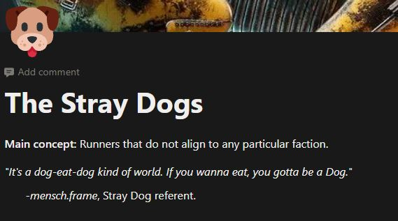
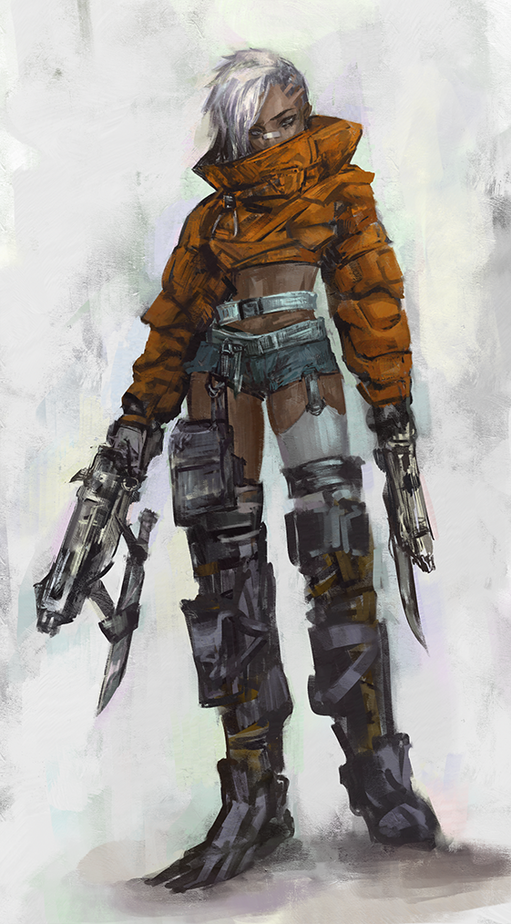
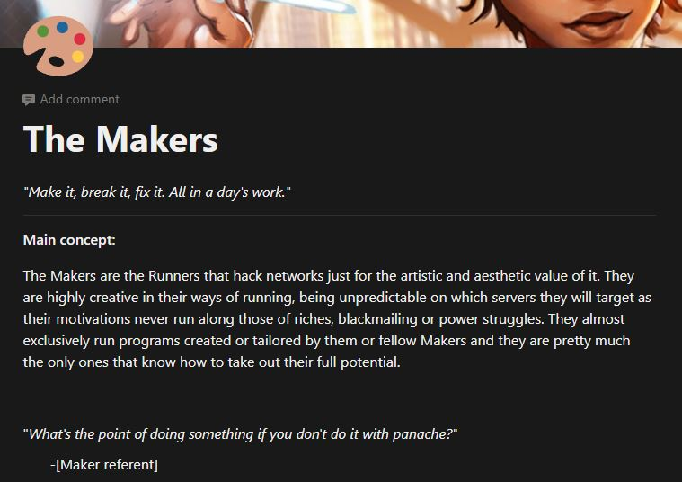
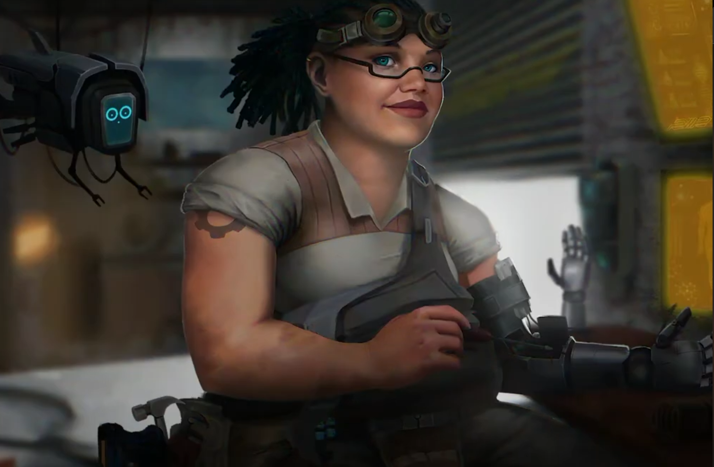
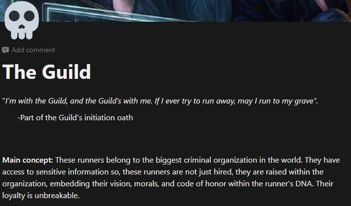
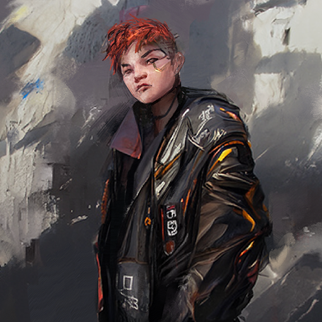
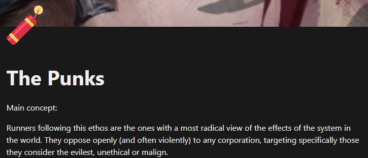
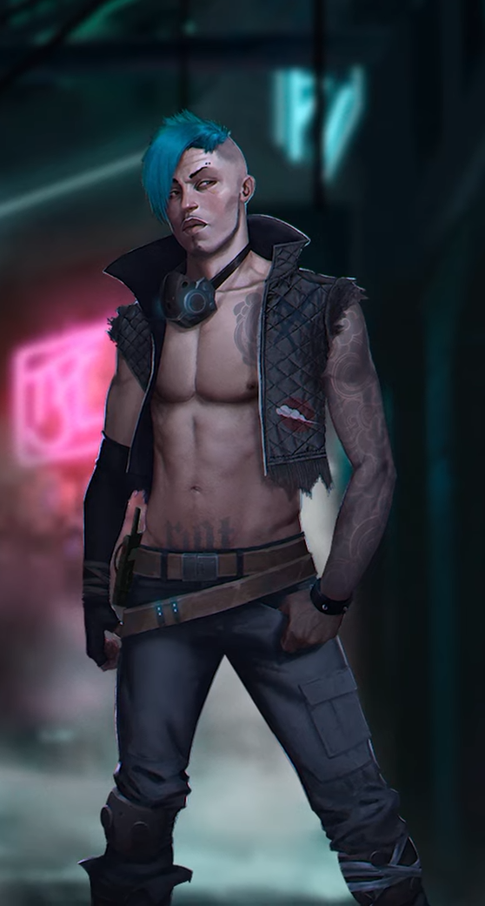
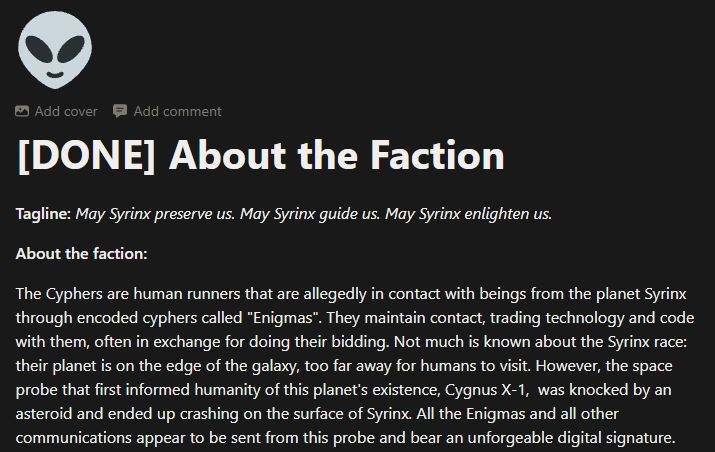
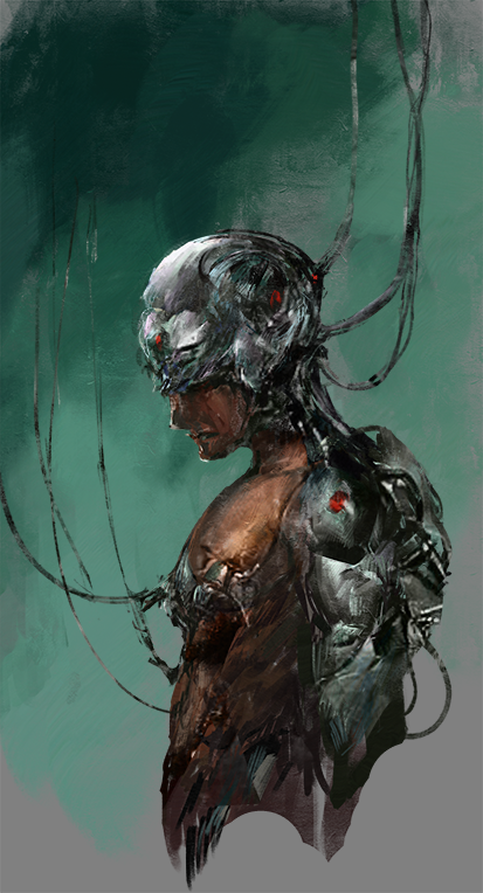

Después de trabajar las megacorporaciones y llevarlas de imágenes borrosas a jugadores medianamente definidos de nuestro universo narrativo, teníamos que aplicar el mismo procesos a los que sabíamos serían los personajes jugables, los hackers, los protagonistas. ¿Qué sabíamos sobre las facciones a las que esos hackers pertenecían? Solo que tenían que ser cinco. También sabíamos que el origen geopolítico no era importante para las facciones de hackers: como toda buena resistencia clandestina, tenían que estar en todas partes y en ninguna a la vez. Eso nos dejaba libres para concentrarnos en la estética y en las motivaciones narrativas como quisiéramos.

La primera facción tenía que ser la base, la de vainilla. Como alguien que ama los sabores de vainilla, entendí que tenía que ser simple pero igual interesante. Después de algunas sesiones de trabajo, decidimos que esta facción estaría formada por mercenarios: hackers que solían trabajar solos pero también podían armar equipos para completar contratos. Cuando surgió la idea de trabajar solo contra trabajar en equipo, algo hizo clic desde lo lingüístico. A quienes trabajan solos se los puede llamar “lobos solitarios”, y la referencia animal nos quedó. Quizás lo opuesto a esos lobos solitarios eran hackers que andaban en manada. También habíamos hablado de hacer de esta la facción más abierta, a la que cualquiera podía unirse si no tenía otro lugar adonde ir. Consideramos todo eso y nos decidimos por un nombre que mantuviera la idea animal, ya que los perros pueden ser solitarios o andar en manada, y que además les quedara bien a quienes no tenían otro lugar adonde ir: los [**Stray Dogs**](https://www.flatline.games/thestraydogs) (algo así como “perros callejeros” en inglés). Su mentalidad general sería el impulso de ser los mejores en su oficio, y su estética sería áspera y muy gastada, señal de experiencia y de una necesidad constante de adaptarse a lo que tuvieran a mano. Como mencioné que hice con las corporaciones en la entrada anterior, y como hice con cada facción posterior a esta, escribí su entrada de referencia.


  
  


*De izquierda a derecha: captura de pantalla de un documento de diseño de los Stray Dogs, representación artística de un hacker Stray Dog.*

Para la segunda facción, queríamos un grupo de hackers streamers e influencers. En mi cabeza, serían algo así como Banksy mezclado con el Project Mayhem de **Fight Club**: borrarían los centros de datos de instituciones financieras para eliminar la deuda de las masas, todo mientras lo transmitían y se aseguraban de que se viera estéticamente sublime. Trabajamos en este concepto bastante tiempo antes de descartarlo, y la verdad es que todavía respaldo esa decisión. Yo pensaba: ¿una facción entera de hackers que no solo ataca con éxito a las corporaciones sino que lo transmite, y a la que casi nunca atrapan? ¿Qué tan buenos son estos hackers? ¿O nuestras corporaciones son completamente inútiles para defenderse? Si estos hackers podían hacer todo eso, eran o bien demasiado poderosos o bien sus oponentes eran inofensivos, y ninguna de las dos cosas es buena para el world-building. Ambas hacen que el riesgo de que ganen los antagonistas sea casi inexistente, y justificarlo narrativamente era un problema.



Así que le pegué un tiro a esa idea, porque era mi responsabilidad decir: “Sé que queremos que esto funcione, pero no está haciendo lo que necesitamos, y va a ser un problema más grande más adelante”. Muchos de los conceptos de esta facción habían venido de integrantes del equipo más arriba en la cadena de mando, y aun así confiaron en mí y me dieron luz verde para volver a empezar de cero y hacer algo distinto, igual de interesante pero menos problemático. La nueva versión conservó el espíritu de hackers que querían hacer cosas con belleza, y la idea de compartir con otros, pero con un giro: serían defensores del copyleft y campeones de la libertad de información. Lo que compartirían sería conocimiento, y si en el curso de sus actividades ciberterroristas deslumbraban a otros hackers con la sofisticación de los programas que escribían o las máquinas que construían, que así fuera. Lo mantuvimos simple y los llamamos los [**Makers**](https://www.flatline.games/themakers) (algo así como "hacedores" en inglés), con un aire general de gente que vive armando y desarmando cosas.


  
  


*De izquierda a derecha: captura de pantalla de un documento de diseño de los Makers, representación artística del concepto actualizado de los Makers.*

Después, queríamos una organización criminal en serio. Todos los hackers son criminales, pero nosotros queríamos algo más al estilo **John Wick**: una sociedad secreta de clase alta. Su espíritu sería la lealtad: los miembros serían reclutados muy jóvenes y recibían acceso a todos los recursos de la organización, y a cambio cumplían cualquier encargo que les dieran. Tendría una jerarquía vertical clara y una estética lujosa y refinada. Como queríamos una amalgama de todas las organizaciones criminales conocidas del mundo, necesitábamos un nombre lo bastante flexible como para abarcar muchas afiliaciones. Coincidimos todos en el [**Guild**](https://www.flatline.games/theguild) (algo así como “el gremio” en inglés). En mi cabeza iba por el lado del Thieves' Guild de **The Elder Scrolls** y de la película **Payback**, de 1999, y recuerdo que otros integrantes del equipo lo asociaban con otros grupos, como el Syndicate de **Android: Netrunner**.


  
  


*De izquierda a derecha: captura de pantalla de un documento de diseño del Guild, representación artística de un miembro del Guild.*

Para nuestra cuarta facción, queríamos un objetivo realmente simple pero contundente: rebelarse. Imaginamos hackers convencidos de que estaban haciendo lo correcto, no por dinero, ego o gloria, sino porque creían que enfrentarse a los opresores debería ser lo natural para cualquiera. También le dimos a esta facción la postura más antitecnológica de todas. Seguirían siendo muy cyberpunk, pero pensamos que el tópico de “preservar nuestra humanidad” podía encontrar un buen hogar en algunos de sus miembros. Como el concepto resultaba bastante clásico, los llamamos los [**Punks**](https://www.flatline.games/thepunks), y decidimos que su estética sería una versión más futurista del look punk estereotípico: implantes cibernéticos con forma de cresta que cambian de color según el humor de quien los lleva, ese tipo de cosas. Era lo bastante clásico como para reconocerse al instante, pero también futurista y de ciencia ficción.


  
  


*De izquierda a derecha: captura de pantalla de un documento de diseño de los Punks, representación artística de un hacker Punk.*

Por último, queríamos algo más extravagante: una facción que ofreciera lo opuesto a lo que los Punks proponían respecto de “preservar la humanidad”. Queríamos hackers muy cómodos con los implantes pesados, con mucho cromo y cables saliéndoles de la cabeza. Trabajamos mucho esta facción en grupo, y muchas de sus ideas centrales no fueron diseño mío, solo ejecución mía. A veces eso fue muy enriquecedor; otras veces, fue fuente de conflicto entre lo que el equipo quería que tuviera la facción y lo que yo, como diseñador narrativo, pensaba que tenía sentido y funcionaría mejor a largo plazo.

Este era el problema. Habíamos decidido que el gusto de esta facción por los implantes y las modificaciones estaría atado a un deseo de alcanzar algún conocimiento superior y secreto, y, como estábamos en 2112, decidimos que creyeran estar en contacto con una raza alienígena. Tendría que haber algo de sustancia en esa afirmación. Algunos integrantes del equipo tenían un deseo genuino y válido de que los alienígenas aparecieran de verdad, porque sería divertido y podría justificar avances tecnológicos que de otro modo se sentirían fuera de lugar. Yo quería preservar la ambigüedad a toda costa. ¿Por qué? Porque los alienígenas confirmados eclipsarían cualquier otro tema de conversación. Pensaba, y sigo pensando, que estábamos construyendo una versión más sombría de nuestro propio mundo, más adelante en el camino, donde temas como la codicia, la compasión, el poder y la libertad todavía tenían lugar y podían explorarse a través de nuestro marco de ciencia ficción. Confirmar que los alienígenas eran reales me parecía que iba a socavar esos temas.

Trabajamos mucho en cómo estos hackers se contactarían con los alienígenas, qué órdenes recibirían y qué jerarquía tendrían. Gran parte de eso terminó recortada, modificada o simplemente marcada como “lo vemos más adelante” (más sobre eso en una entrada futura), pero el concepto de un grupo de hackers muy modificados y obsesionados con la existencia de alienígenas era lo bastante sólido como para conservarlo, aunque no coincidiéramos en todos los detalles. Volvimos a **Rush** para el nombre de la raza alienígena, los Syrinx. Si no escuchaste **The Temples of Syrinx**, yo lo recomiendo; creo que es una de mis favoritas de la banda. Para los hackers en sí, como queríamos que fueran enigmáticos y misteriosos, elegimos el nombre [**Cyphers**](https://www.flatline.games/thecyphers) (algo así como "los cifrados" en inglés).


  
  


*De izquierda a derecha: captura de pantalla de un documento de diseño de los Cyphers, arte conceptual de un hacker Cypher.*

Toda esta parte del proceso de diseño tomó una necesidad narrativa (“necesitamos cinco megacorporaciones distintas y cinco facciones de hackers distintas”) y la fue volviendo cada vez más específica hasta que se sintió sólida e interesante. Me gusta pensarlo como la forma en que se cargaban las imágenes en las computadoras muy viejas, en varias pasadas: primero un borrón, cada vez más nítido con cada una. Empezamos con trazos muy gruesos y fuimos sumando detalle hasta que quedamos conformes con el resultado.

Mirando para atrás, creo que hicimos un buen trabajo priorizando lo que nosotros, como equipo, necesitábamos que fuera el producto, dejando lugar para los deseos y gustos individuales. Después de todo, a todos nos importaba que nos gustara lo que estábamos construyendo, y eso no es poca cosa. Como mencioné en la entrada anterior, yo no había propuesto este proyecto, me habían invitado a participar de él, así que acomodar los deseos de otros stakeholders y a la vez asegurarme de que mi diseño narrativo se sostuviera me importaba mucho: mi trabajo está impregnado de cómo me siento con él, y si odio el proceso probablemente odie el producto. Sentirme bien con las decisiones que tomamos como equipo, y con la manera en que las tomamos, mejoraba mis posibilidades de no vivir el trabajo como una carga. Estoy seguro de que tener en cuenta los aportes de mis compañeros, y esforzarme por encontrar la mejor manera de incorporarlos a nuestro mundo, también los hizo sentirse mejor con el proyecto.

Lamento decir que no siempre lo logré, y que a veces no me esforcé lo suficiente. Yo tenía mi propia visión de lo que era un buen world-building, y a veces las ideas de los otros simplemente no encajaban ahí. Me gusta creer que nunca puse mis caprichos por sobre el mejor interés del proyecto, pero seguramente fui demasiado vehemente en ocasiones, y esa actitud erosionó parte de la alegría que mis compañeros podrían haber encontrado en ser parte del proceso de diseño narrativo. Se los reconocí y les pedí disculpas, y lo que puedo hacer ahora es mantenerme atento a cuán fácil o difícil les resulta a los demás participar en un proceso que es tan de ellos como mío.

Y en esa línea, acompañame en la próxima entrada, donde voy a hablar con más detalle de las herramientas que armé para que mis compañeros pudieran participar activamente en el diseño de nuestros primeros personajes completamente desarrollados: los CEO de nuestras megacorporaciones.
