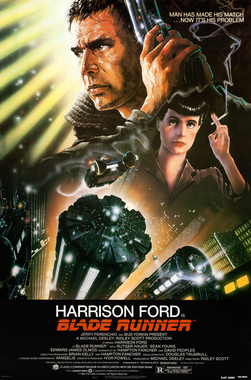
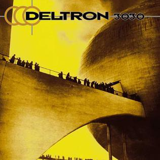
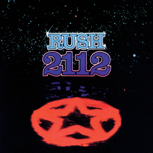

When I took my first steps into narrative design, it felt like an amorphous activity, something that refused to be defined by static limits. That lack of clear boundaries made it intimidating and hard to approach. Five years later, I think that while the job is certainly multifaceted and requires a fair degree of flexibility on the designer's part, it's not the inaccessible discipline I once thought it was.

I'm writing these articles for several reasons: because I think narrative design is a delightful job, and perhaps others hesitate to pursue it; because I think the narrative work done for **Into The Grid** is good enough to be shared outside the context of the final product; but mostly because I would have liked to read something like this when I started. Not a decalogue of Do's and Don'ts, and certainly not an abstract, unquestionable guide that ought to rule every aspect of the job, but a real experience from which one could gather some insight. I doubt there's any wisdom here that can tell others which path to follow (my beard is not long enough to give advice); I'm just trying to tell them where I've been and what I did. Hopefully, they can extrapolate my successes to make them their own, while avoiding some of my mistakes (which are infinite and grave).

So, what better place to start talking about the narrative design for **Into The Grid** than at the beginning? Sometime around 2021, a friend messaged me about a project he and his brother had in mind. They (both of whom eventually funded **Flatline Studios**) wanted someone to help with the storytelling and world-building. I said yes, and we scheduled a call so we could talk about it. I had no idea what they had in mind—whether they wanted to make a game, a movie, or a comic book. I just knew I wanted to write more than anything in the world, and that my love for this friend was strong enough to say yes to anything he proposed. And luckily, I did.

We had the call, and although a lot of the details are fuzzy after so many years, I do remember one thing we established with certainty: they wanted a sci-fi, cyberpunk, dystopian world in which hackers fought corporations. And I do want to make that distinction: *they* wanted it. And it's not that I wanted something different; it's that I think it's important to know whose hand is on the wheel. Not only because hierarchies help organise the actual work, but because knowing who you're trying to please is a good thing. Designing for a faceless crowd is terrifying; it's impossible to know what they'll like until you've shown them your work, and if you miss, you might not get a second chance at it. Having someone tell you, "I'm the audience," is great for target practice. Sure, later on you might have to adjust your sights to hit centre with your audience, but having that initial bearing is worth its weight in gold.

Aside from defining those broad genre strokes, we also discussed references. They mentioned **Rush**'s album **2112**. I brought the rap opera album **Deltron 3030** to the conversation. We all talked about how much we loved the original **Blade Runner**. At some point, I'm sure **Johnny Mnemonic** and **ReBoot** came up. Not all of these references ended up hardcoded in Into The Grid, but they all informed the conversation we were having. How far into the future do we want our world to be? The year 3030 was too far away for us to easily identify ourselves in it. 2112 was much closer to home, far enough to be different, but not so distant that we had to reimagine every human experience. Some cultural references were useful for their aesthetics; others, for the way they explored mechanics we thought were fun and interesting. In the end, what mattered was that we could point at these references and say, "I think we should play around with this concept," then separate it from its source and see how it fit into our own emerging world.


  
  
  


I now had some idea of the narrative context I had to build. But that alone wasn't really enough. What was I building for? What use would my creation have? Was the end goal to write the story of how one fully fleshed-out hero brought that dystopian world down and made a better one (and then make a movie out of it), or did I have to come up with dozens of blank-slate characters that anybody could identify with in a world that was unchanged by those characters' actions? We had another working session to make some decisions. In the end, we emerged with a couple of hard facts: first, the narrative would centre on five distinct factions of hackers who would form the last line of resistance against the five megacorporations that ruled Earth with an iron fist. Second, we were making a multiplayer role-playing experience that would react to the players' actions. One player's behaviour would shape the world for everyone else, and everyone could meaningfully impact its narrative.

At this point, dear reader, I must tell you that Into The Grid is not a multiplayer role-playing game; it is a single-player deckbuilder. Why? Because things change. Scopes broaden and narrow. Funding comes in and runs dry. And that's part of the job. Of course, if the whole point of your project is to tell a specific story you're set on, by all means, don't compromise anything and fight tooth and nail to ensure you get to tell that story. But when you're building a world to help someone else's vision crystallise, you need to learn to be flexible and adapt. When that call ended, I was sure I had a clear definition of what we were building and how it would be used. However, in a process as long and as complex as creating a game, a movie, an IP, or whatever, hard facts are not that hard. You might move in one direction only to find out the final destination was the other way. You might write thousands of words of content that won't ever be read or integrated into the final product (I know I have). The important thing to me is moving forward, whatever forward means at the time. I don't regret having designed more than 5,000 origin stories for an RPG that never happened; I learned a lot doing that work about the world I was building, its inhabitants, and myself as a writer. *I only regret not being able to adapt better to the changes*.



Frustration is a mighty foe, and I hate to sound like a self-help book, but in the context of building something, one must be ready to adapt. Otherwise, it's a world of pain and deception. In my mind, world-building is about figuring out what can exist around what you want to create. Sometimes you think a story, a character, or a concept fits perfectly, only to discover it undermines everything else you've built. Sometimes you build something that works fine, only to be told afterwards that the purpose of the narrative has changed and what you have is no longer useful. If you're like me, here's the approach that saved me: it's a puzzle. It's a challenge to solve: *"How can I tell a story that I think is cool, fun, and interesting, using the resources I have while serving a greater objective?"*

And while a lot of things didn't make it further down the line, there were some things we got right on the first try: **a dystopian future where five factions of hackers fought five megacorporations**. That foundation was solid enough that it still supports our whole narrative universe. And I'll tell you more about what we built on that foundation in the next entry.
