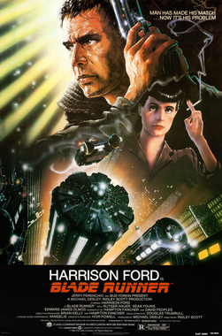
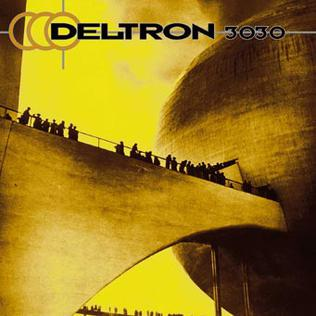
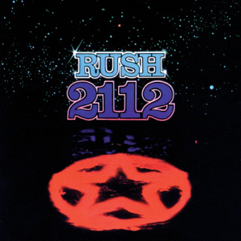

Cuando di mis primeros pasos en el diseño narrativo, me parecía una actividad amorfa, algo que se resistía a quedar encerrado en límites definidos. Esa falta de fronteras claras la volvía una tarea intimidante y difícil de abordar. Cinco años después, creo que, si bien el trabajo es sin dudas multifacético y exige mucha flexibilidad de parte de quien diseña, no es la disciplina inaccesible que alguna vez imaginé.

Escribo estos artículos por varias razones: porque creo que el diseño narrativo es un trabajo hermoso y quizás haya otras personas que no se animen a dedicarse a él; porque creo que el trabajo narrativo que se hizo para **Into The Grid** es lo bastante bueno como para compartirlo fuera del contexto del producto final; pero sobre todo porque a mí me hubiera encantado leer algo así cuando empecé. No un decálogo de qué hacer y qué no hacer, y mucho menos una guía abstracta e incuestionable que pretenda regir cada aspecto del oficio, sino una experiencia real de la que se pueda sacar alguna idea. Dudo que haya acá alguna sabiduría capaz de decirles a otros qué camino seguir (*nadie puede dar consejos, no hay hombre que sea tan viejo*); solo intento contarles dónde estuve y qué hice. Ojalá puedan tomar mis aciertos y hacerlos propios, y de paso evitar algunos de mis errores (que son infinitos y graves).

Entonces, ¿qué mejor lugar para empezar a hablar del diseño narrativo de **Into The Grid** que el principio? Allá por 2021, un amigo me escribió para contarme de un proyecto que tenía en mente con su hermano. Ellos (ambos terminaron fundando **Flatline Studios**) buscaban a alguien que los ayudara con la narración y la construcción del mundo. Dije que sí y agendamos una llamada para hablarlo. No tenía idea de qué tenían en mente: si querían hacer un juego, una película o un cómic. Solo sabía que quería escribir más que nada en el mundo, y que el cariño que le tengo a este amigo era suficiente para decirle que sí a cualquier cosa que me propusiera. Y por suerte, dije que sí.

Tuvimos la llamada y, aunque muchos detalles están borrosos después de tantos años, recuerdo con certeza algo que establecimos: ellos querían un mundo de ciencia ficción, cyberpunk y distópico, en el que hackers pelearan contra corporaciones. Y quiero marcar esa distinción: *ellos* lo querían. No es que yo quisiera algo distinto; es que me parece importante saber quién tiene las manos en el timón. No solo porque las jerarquías ayudan a organizar el trabajo concreto, sino porque saber a quién querés complacer es algo útil. Diseñar para una multitud sin rostro da pavor: es imposible saber qué les va a gustar hasta que les muestres tu trabajo, y si errás, puede que no tengas una segunda oportunidad. Que alguien te diga "el público objetivo soy yo" es excelente para practicar puntería. Obvio que después quizás tengas que corregir la mira para dar en el centro del blanco con tu audiencia, pero contar con ese rumbo inicial vale su peso en oro.

Además de definir esos trazos gruesos de género, también hablamos de referencias. Mencionaron el álbum **2112**, de **Rush**. Yo llevé a la conversación el álbum de ópera rap **Deltron 3030**. Todos coincidimos en cuánto amábamos la **Blade Runner** original. En algún momento de la charla, estoy seguro de que salieron **Johnny Mnemonic** y **ReBoot**. No todas estas referencias quedaron grabadas a fuego en **Into The Grid**, pero todas orientaron la conversación que estábamos teniendo. ¿Qué tan lejos en el futuro queríamos que estuviera nuestro mundo? El año 3030 nos quedaba demasiado lejos como para que resultara fácil reconocernos en él. 2112 estaba mucho más cerca: lo bastante lejos como para ser distinto, pero no tanto como para tener que reimaginar todas las experiencias humanas. Algunas referencias nos servían por su estética; otras, por la forma en que exploraban mecánicas que nos parecían divertidas e interesantes. Al final, lo que importaba era poder señalar esas referencias y decir "creo que deberíamos jugar con este concepto", para después separarlo de su origen y ver cómo encajaba en nuestro propio mundo en formación.


  
  
  


Ya tenía una idea del contexto narrativo que tenía que construir. Pero eso solo no alcanzaba. ¿Para qué lo estaba construyendo? ¿Qué uso iba a tener mi creación? ¿El objetivo final era escribir la historia de cómo un héroe completamente desarrollado derribaba ese mundo distópico y levantaba uno mejor (y después hacer una película), o tenía que inventar docenas de personajes en blanco con los que cualquiera pudiera identificarse, en un mundo que las acciones de esos personajes no cambiaban? Tuvimos otra sesión de trabajo para tomar decisiones. Al final, salimos con un par de datos duros: primero, la narrativa se centraría en cinco facciones distintas de hackers que serían la última línea de resistencia contra las cinco megacorporaciones que gobernaban la Tierra con mano de hierro. Segundo, íbamos a hacer una experiencia de rol multijugador que reaccionara a las acciones de los jugadores. El comportamiento de un jugador moldearía el mundo para todos los demás, y cualquiera podría tener un impacto real en su narrativa.

A esta altura, querido lector, tengo que decirte que **Into The Grid** no es un juego de rol multijugador; es un deckbuilder para un solo jugador. ¿Por qué? Porque las cosas cambian. Los scopes se amplían y se achican. Entra financiamiento y se va. Y eso es parte del trabajo. Por supuesto, si el sentido de tu proyecto es contar una historia específica que tenés decidida, adelante: no cedas en nada y peleá a muerte para poder contarla. Pero cuando estás construyendo un mundo para ayudar a que la visión de otra persona se cristalice, tenés que aprender a ser flexible y adaptarte. Cuando terminó esa llamada, estaba seguro de tener una definición clara de qué estábamos construyendo y cómo se iba a usar. Sin embargo, en un proceso tan largo y complejo como crear un juego, una película, una IP o lo que sea, los datos duros no son tan duros. Podés avanzar en una dirección y descubrir que el destino final estaba para el otro lado. Podés escribir miles de palabras de contenido que nunca se van a leer ni a integrar en el producto final (lo digo por experiencia propia). Lo importante para mí es seguir avanzando, sea lo que sea que "avanzar" signifique en cada momento. No me arrepiento de haber diseñado más de 5.000 historias de origen para un RPG que nunca existió; aprendí mucho con ese trabajo sobre el mundo que estaba construyendo, sus habitantes y yo mismo como escritor. *Lo único que lamento es no haber podido adaptarme mejor a los cambios*.



La frustración es una enemiga formidable, y odio sonar como un libro de autoayuda, pero cuando uno está construyendo algo hay que estar listo para adaptarse. De lo contrario, es un mundo de dolor y decepción. Para mí, construir mundos consiste en descubrir qué puede existir alrededor de lo que querés crear. A veces pensás que una historia, un personaje o un concepto encaja a la perfección, y después descubrís que socava todo lo demás que construiste. A veces construís algo que funciona bien, y después te dicen que el propósito de la narrativa cambió y que lo que tenés ya no sirve. Si sos como yo, el enfoque que me salvó es este: es un rompecabezas. Es un desafío para resolver: *"¿Cómo puedo contar una historia que me parezca copada, divertida e interesante, con los recursos que tengo y al servicio de un objetivo mayor?"*

Y aunque muchas cosas no sobrevivieron, hubo otras que acertamos a la primera: **un futuro distópico donde cinco facciones de hackers luchaban contra cinco megacorporaciones**. Esa base fue lo bastante sólida como para que todavía hoy sostenga todo nuestro universo narrativo. Y en la próxima entrada te cuento más sobre lo que construimos sobre esa base.
